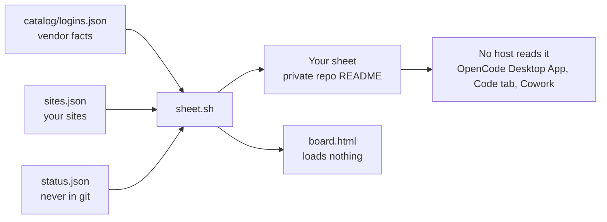

# Logins

Sign in to every vendor one way, in one order, with each passkey and code in a known place. [catalog/logins.json](../catalog/logins.json) holds what each vendor offers. [templates/logins/](../templates/logins/README.md) turns it into your own sheet and board.

| Choice | Starter default | Why |
| --- | --- | --- |
| Sign-in order | GitHub, Apple, Microsoft, Google, then email and password | One order is one habit. Change `order` in `sites.json` |
| Identity providers | Their own passkey, never another provider | A provider reached through another one falls with it |
| Email | Apple, Microsoft and Google services use that company's account. All else uses one public address | The address that signs in to your password vault stays private |
| Hide My Email | Not on accounts you link | A relay address matches none of your other sign-ins |
| Codes | Apple Passwords. Microsoft accounts in Microsoft Authenticator, Google accounts in Google Authenticator | Change `codes` in `sites.json` |

## Wiring

| Host | Plugs in as | Source, read 2026-11-24 |
| --- | --- | --- |
| OpenCode Desktop App | Not available. The sheet and board are local files. | [templates/logins](../templates/logins/README.md) |
| Claude Desktop App, Code tab | Not available. No connector reads the catalog. | [templates/logins](../templates/logins/README.md) |
| Claude Desktop App, Cowork | Not available. No connector reads the catalog. | [templates/logins](../templates/logins/README.md) |

## Where each secret lives

| Secret | Place | Source |
| --- | --- | --- |
| Passwords, passkeys, codes | Apple Passwords, synced by iCloud Keychain | [Passwords app](https://support.apple.com/en-us/120758), read 2026-11-22 |
| A code in Passwords | Edit the site's entry, choose Set Up Code, paste the setup key | [Verification codes](https://support.apple.com/guide/passwords/mchl873a6e72/mac), read 2026-11-22 |
| Passkeys made in Chrome | iCloud Keychain, once Chrome is allowed to use it | [Passkeys on iCloud Keychain](https://developer.chrome.com/blog/passkeys-on-icloud-keychain), read 2026-11-22 |
| Recovery codes | The site's Passwords entry, plus one printed copy per identity provider | Print it: it is the way in when the vault is locked |
| One entry per site | Give the password entry exactly the passkey entry's user name, capitals included: the two join | Seen in the Passwords app, 2026-11-22 |

Six steps for one account: [Logins: six steps and the catalog](detail/logins.md). Traps: [Logins traps](detail/logins-traps.md).
