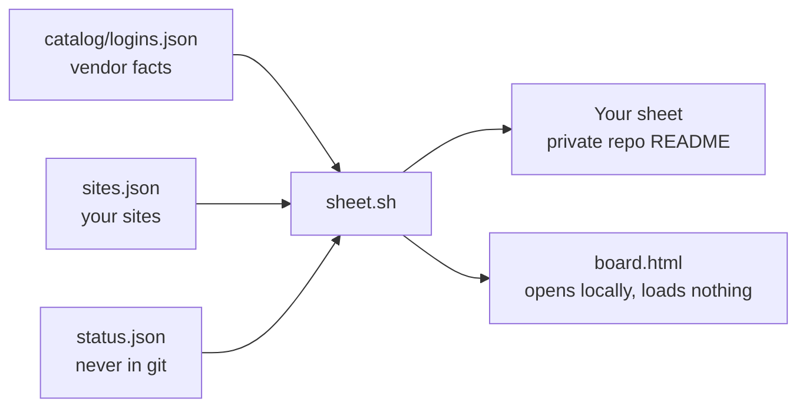
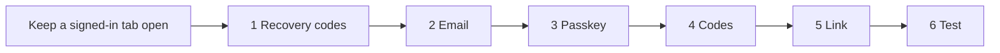

# Logins

Sign in to every vendor one way, in one order, with each passkey and code in a known place. [catalog/logins.json](../catalog/logins.json) holds what each vendor offers. [templates/logins/](../templates/logins/README.md) turns it into your own sheet and board.

## Pick once

| Choice | Starter default | Why |
| --- | --- | --- |
| Sign-in order | GitHub, Apple, Microsoft, Google, then email and password | One order is one habit. Change `order` in `sites.json` |
| Identity providers | Their own passkey, never another provider | A provider reached through another one falls with it |
| Email | Apple, Microsoft and Google services use that company's account. All else uses one public address | The address that signs in to your password vault stays private |
| Hide My Email | Not on accounts you link | A relay address matches none of your other sign-ins, so a link fails or makes a second account |
| Codes | Apple Passwords. Microsoft accounts in Microsoft Authenticator, Google accounts in Google Authenticator | Change `codes` in `sites.json` |

## Where each secret lives

| Secret | Place | Source |
| --- | --- | --- |
| Passwords, passkeys, verification codes | Apple Passwords, synced by iCloud Keychain | [Passwords app](https://support.apple.com/en-us/120758), read 2026-11-22 |
| A code in Passwords | Edit the site's entry, choose Set Up Code, paste the setup key | [Verification codes](https://support.apple.com/guide/passwords/mchl873a6e72/mac), read 2026-11-22 |
| Passkeys made in Chrome | iCloud Keychain, once Chrome is allowed to use it | [Passkeys on iCloud Keychain](https://developer.chrome.com/blog/passkeys-on-icloud-keychain), read 2026-11-22 |
| Recovery codes | The site's Passwords entry, plus one printed copy per identity provider | Print it: it is the way in when the vault is locked |
| One entry per site | Give the password entry exactly the passkey entry's user name, capitals included: the two join. A Sign in with Apple entry stays apart and holds no code | Seen in the Passwords app, 2026-11-22 |

## One account, six steps

| Step | Rule |
| --- | --- |
| 1 Recovery codes | Save new codes before you change anything |
| 2 Email | Set the email before you link Apple: some vendors unlink Apple when the email changes |
| 3 Passkey | Add it, then check that Passwords offers it at the next sign-in |
| 4 Codes | Enrol the code in the right app and confirm it with a fresh code |
| 5 Link | Link from account settings, never by a fresh sign-in through a second provider |
| 6 Test | Sign out in a private window and sign in with the new method |

Harden the identity providers first: every vendor you reach through one inherits its security. Remove an old factor only after all six steps pass.

## Traps

| Trap | What happens | Source |
| --- | --- | --- |
| Moving codes out of Google Authenticator | Its export QR code holds every secret at once. Re-enrol each site instead | [Google Authenticator](https://support.google.com/accounts/answer/1066447), read 2026-11-22 |
| A new authenticator | On many sites it replaces the old one at once | Save recovery codes first (step 1) |
| Social sign-in at DigitalOcean | Its 2FA covers password sign-ins only; with Google or GitHub, 2FA lives at that provider | [DigitalOcean 2FA](https://docs.digitalocean.com/platform/accounts/2fa/), read 2026-11-22 |
| Changing the email at Cloudflare | It unlinks Apple; signing in with Apple again makes a new account | [Cloudflare login](https://developers.cloudflare.com/fundamentals/user-profiles/login/), read 2026-11-22 |
| Together AI | Sign in only with the provider you signed up with; the email cannot be changed directly | [Together AI sign-in](https://api.together.ai/signin), read 2026-11-22 |
| A social button on a site you have not used | DigitalOcean, Vast.ai and NVIDIA make a new account at once, with no question. Sign in the way you signed up | Seen 2026-11-22 |
| A second provider at NVIDIA | Apple or Google under another email makes a second, empty account; its settings can only unlink | [NVIDIA security settings](https://profile.nvgs.nvidia.com/security), seen 2026-11-22 |
| Extra accounts for more free use | NVIDIA's terms forbid using it "to avoid incurring fees or exceeding use limits or quotas" | [NVIDIA Technology Access Terms](https://developer.nvidia.com/legal/terms) 5(n), read 2026-11-22 |
| Testing in the same browser profile | The session cookie signs you in, so the test proves nothing | Use a private window (step 6) |

Every vendor's own trap is in the `trap` column of [catalog/logins.json](../catalog/logins.json).

## The catalog

| Rows | Verified | Passkey offered | Social sign-in only |
| --- | --- | --- | --- |
| 44 | 28 | 7 | 7 |

Counts are from `catalog/logins.json` as built on 2026-11-22. A `null` field means the vendor's own pages did not say. Fill one in through [CONTRIBUTING.md](../CONTRIBUTING.md) or the Sign-in facts issue form.
