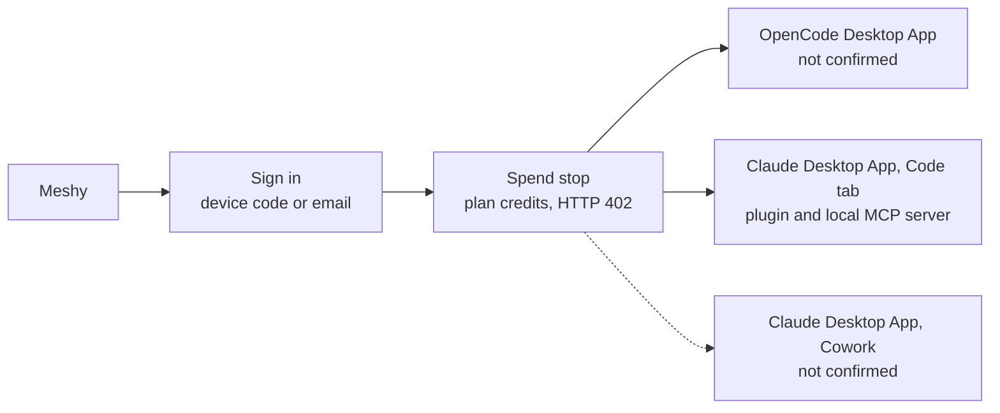

# Meshy

Meshy turns a picture or a prompt into a textured 3D model, then remeshes, rigs and animates it. Tools and skills reach the Claude Desktop App; Meshy is not a model provider.



| Account | Free tier | Login or key | Claude connector | OpenCode | Guard |
| --- | --- | --- | --- | --- | --- |
| Email or Google sign-in. Free needs no credit card ([Pricing](https://www.meshy.ai/pricing), read 2026-11-24). | Free: 100 credits a month, 1 task at a time. API and MCP need Pro: $20 monthly for 1,000 credits ([Pricing](https://www.meshy.ai/pricing), read 2026-11-24). | `meshy auth login --device` approves a code in the browser ([INSTALL.md](https://github.com/meshy-dev/meshy-3d-agent/blob/main/INSTALL.md), read 2026-11-24). The MCP server reads `MESHY_API_KEY`. | None hosted: it "lets only ChatGPT sign in today" ([Meshy MCP](https://www.meshy.ai/mcp), read 2026-11-24). Use the plugin or local server. | No provider. Any stdio MCP client runs the local server ([Meshy MCP](https://www.meshy.ai/mcp), read 2026-11-24). | Plan credits, then HTTP 402 ([Errors](https://docs.meshy.ai/en/api/errors), read 2026-11-24). A credit pack removes the stop. [Guard detail](detail/meshy.md#guard). |

## Wiring

| Host | Plugs in as | Source, read 2026-11-24 |
| --- | --- | --- |
| OpenCode Desktop App | Not confirmed. Meshy says any stdio MCP client works. OpenCode's page names no Desktop screen for adding a server. | [Meshy MCP](https://www.meshy.ai/mcp), [OpenCode MCP](https://opencode.ai/docs/mcp-servers) |
| Claude Desktop App, Code tab | Plugin `meshy-3d-generation` from the Plugins screen, or the local MCP server. Meshy's page names the Code tab. | [Meshy MCP](https://www.meshy.ai/mcp), [Desktop docs](https://code.claude.com/docs/en/desktop) |
| Claude Desktop App, Cowork | Not confirmed. Cowork takes connectors and plugins from your claude.ai account. Meshy names no Cowork step. | [Desktop docs](https://code.claude.com/docs/en/desktop), [Meshy MCP](https://www.meshy.ai/mcp) |

## Credits per character

| Step | Credits ([API pricing](https://docs.meshy.ai/en/api/pricing), read 2026-11-24) |
| --- | --- |
| Image to 3D, 2K or 4K textures | 30 |
| Rigging | 5 |
| Animation | 3 per action |
| **One rigged character, one action, no remesh** | **38** (computed). Pro's 1,000 credits ([Pricing](https://www.meshy.ai/pricing), read 2026-11-24) cover about 26 (computed) |

<details>
<summary>Commands</summary>

```bash
npm install -g meshy-cli@0.8
meshy auth login --device
meshy balance
meshy make ./hero.png --dry-run
```

</details>

Guard, set-up steps and the MCP route: [Meshy detail](detail/meshy.md). Traps and sources: [Meshy traps and sources](detail/meshy-traps.md).
