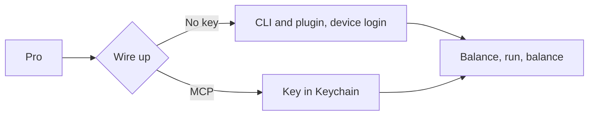

# Meshy

Meshy turns a picture or a prompt into a textured 3D model, then remeshes, rigs and animates it, so Claude Code can make game-ready characters on Pro.

| Account | Free tier | Login or key | Claude connector | OpenCode | Guard |
| --- | --- | --- | --- | --- | --- |
| Email or Google sign-in. Free needs "No credit card" ([Pricing](https://www.meshy.ai/pricing), read 2026-11-24). Tasks from Claude Code need Pro or above: Free tasks get HTTP 402 `plan_upgrade_required` ([meshy-3d-agent](https://github.com/meshy-dev/meshy-3d-agent), read 2026-11-24). | Free: 100 credits a month, 10 assets and 1 task at a time ([Pricing](https://www.meshy.ai/pricing), read 2026-11-24). Pro: $20 billed monthly for 1,000 credits a month, with API and MCP access ([Pricing](https://www.meshy.ai/pricing), read 2026-11-24). "Plan credits reset monthly and do not accumulate". | `meshy auth login --device`: approve a code in the browser, so no key reaches the machine ([INSTALL.md](https://github.com/meshy-dev/meshy-3d-agent/blob/main/INSTALL.md), read 2026-11-24). The MCP server reads `MESHY_API_KEY`, an `msy_` key shown once ([Authentication](https://docs.meshy.ai/en/api/authentication), read 2026-11-24). | None hosted: Meshy's server "lets only ChatGPT sign in today" ([Meshy MCP](https://www.meshy.ai/mcp), read 2026-11-24). Use the `meshy-3d-generation` plugin, or the local `@meshy-ai/meshy-mcp-server`. | None as a model provider. The local MCP server runs in any stdio MCP client (same page). | Plan credits are the stop: too few gets HTTP 402 ([Errors](https://docs.meshy.ai/en/api/errors), read 2026-11-24). An extra credit pack removes it ([Pricing](https://www.meshy.ai/pricing), read 2026-11-24). A key can carry a Monthly credit limit ([Authentication](https://docs.meshy.ai/en/api/authentication), read 2026-11-24). [Git Crafter compute rules](https://github.com/SoulCraft-Org/git-crafter/blob/main/rules/compute.md) |



## Credits per character

| Step | Credits ([API pricing](https://docs.meshy.ai/en/api/pricing), read 2026-11-24) |
| --- | --- |
| Image to 3D, mesh with 2K or 4K textures | 30 |
| Remesh to a face count, if needed | 5 |
| Rigging | 5 |
| Animation, up to 10 actions a request | 3 per action |
| **One rigged character, one action** | **38** (computed); Pro's 1,000 credits a month ([Pricing](https://www.meshy.ai/pricing), read 2026-11-24) cover about 26 (computed) |

## Set up

1. Subscribe to Pro or above at https://www.meshy.ai/pricing. Buy no extra pack: the plan's credits stay the only stop.
2. Install the CLI and plugin. The skills are written for meshy-cli 0.8 on Node.js 22.12 or later ([meshy-3d-agent](https://github.com/meshy-dev/meshy-3d-agent), read 2026-11-24).

   ```bash
   npm install -g meshy-cli@0.8
   claude plugin marketplace add meshy-dev/meshy-3d-agent
   claude plugin install meshy-3d-generation@meshy-3d-agent
   ```

3. Sign in. The device flow prints a code: approve it at `https://www.meshy.ai/device` within 10 minutes ([INSTALL.md](https://github.com/meshy-dev/meshy-3d-agent/blob/main/INSTALL.md), read 2026-11-24). The CLI stores the session encrypted under a Keychain key on macOS (`meshy --help`, meshy-cli 0.8.8, read 2026-11-24).

   ```bash
   meshy auth login --device
   meshy auth status
   ```

4. Price the run first. `--dry-run` prints the steps and a credit estimate, no spend; `--max-credits` refuses a run estimated over it (same source).

   ```bash
   meshy balance
   meshy make ./hero.png --dry-run
   meshy make ./hero.png -o out/hero/ --max-credits 40
   meshy balance
   ```

5. Save each model as its task finishes: Meshy deletes API output three days after generation ([Terms of Use](https://www.meshy.ai/terms-of-use), read 2026-11-24).

More: [MCP steps, traps and sources](detail/meshy.md).
