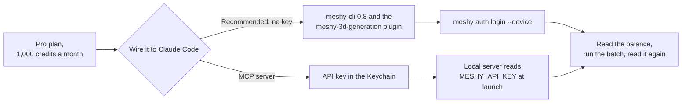

# Meshy

Meshy turns one picture or a prompt into a textured 3D model, then remeshes, rigs and animates it, so Claude Code can make game-ready characters on a Pro subscription.

| Account | Free tier | Login or key | Claude connector | OpenCode | Guard |
| --- | --- | --- | --- | --- | --- |
| Anyone with an email or a Google sign-in. Free needs "No credit card" ([Pricing](https://www.meshy.ai/pricing), read 2026-11-24). Creating tasks from Claude Code needs Pro or above. A Free account signs in, but its tasks get HTTP 402 `plan_upgrade_required` ([meshy-3d-agent](https://github.com/meshy-dev/meshy-3d-agent), read 2026-11-24). | Free: 100 credits a month, 10 assets and 1 task at a time ([Pricing](https://www.meshy.ai/pricing), read 2026-11-24). Pro: $20 billed monthly for 1,000 credits a month ([Pricing](https://www.meshy.ai/pricing), read 2026-11-24). Pro adds API and MCP access. "Plan credits reset monthly and do not accumulate" ([Pricing](https://www.meshy.ai/pricing), read 2026-11-24) | `meshy auth login --device` asks you to approve a code in the browser. No key reaches the machine ([INSTALL.md](https://github.com/meshy-dev/meshy-3d-agent/blob/main/INSTALL.md), read 2026-11-24). The MCP server reads `MESHY_API_KEY`, an `msy_` key shown once ([Authentication](https://docs.meshy.ai/en/api/authentication), read 2026-11-24) | None hosted for Claude. Meshy's hosted server "lets only ChatGPT sign in today" ([Meshy MCP](https://www.meshy.ai/mcp), read 2026-11-24). In Claude Code, use the `meshy-3d-generation` plugin over the CLI. Or run the local server `@meshy-ai/meshy-mcp-server` | None as a model provider. The local MCP server runs in any stdio MCP client ([Meshy MCP](https://www.meshy.ai/mcp), read 2026-11-24) | Plan credits are the stop. A request without enough credits gets HTTP 402 ([Errors](https://docs.meshy.ai/en/api/errors), read 2026-11-24). Buying an extra credit pack removes it ([Pricing](https://www.meshy.ai/pricing), read 2026-11-24). An API key can also carry a Monthly credit limit ([Authentication](https://docs.meshy.ai/en/api/authentication), read 2026-11-24). [Git Crafter compute rules](https://github.com/SoulCraft-Org/git-crafter/blob/main/rules/compute.md) |



## Credits per character

| Step | Credits | Source |
| --- | --- | --- |
| Image to 3D, mesh with 2K or 4K textures | 30 | [API pricing](https://docs.meshy.ai/en/api/pricing), read 2026-11-24 |
| Remesh to a face count, when the mesh needs it | 5 | [API pricing](https://docs.meshy.ai/en/api/pricing), read 2026-11-24 |
| Rigging | 5 | [API pricing](https://docs.meshy.ai/en/api/pricing), read 2026-11-24 |
| Animation, up to 10 actions a request | 3 per action | [API pricing](https://docs.meshy.ai/en/api/pricing), read 2026-11-24 |
| **One rigged character with one action** | **38** (computed). Pro's 1,000 credits a month ([Pricing](https://www.meshy.ai/pricing), read 2026-11-24) cover about 26 (computed) | The rows above |

## Set up

1. Subscribe to Pro or above at https://www.meshy.ai/pricing. Buy no extra credit pack: the plan's credits then stay the only stop.
2. Install the CLI. The skills are written for meshy-cli 0.8 on Node.js 22.12 or later ([meshy-3d-agent](https://github.com/meshy-dev/meshy-3d-agent), read 2026-11-24).

   ```bash
   npm install -g meshy-cli@0.8
   meshy --version
   ```

3. Add Meshy's plugin marketplace and install the generation skill. Its `.claude-plugin/marketplace.json` lists `meshy-3d-generation` and `meshy-3d-printing` ([meshy-3d-agent](https://github.com/meshy-dev/meshy-3d-agent), read 2026-11-24). The commands follow [Discover plugins](https://code.claude.com/docs/en/discover-plugins), read 2026-11-24.

   ```bash
   claude plugin marketplace add meshy-dev/meshy-3d-agent
   claude plugin install meshy-3d-generation@meshy-3d-agent
   ```

   Meshy's docs install the same skills with `npx skills add meshy-dev/meshy-3d-agent` ([AI integration](https://docs.meshy.ai/en/api/ai), read 2026-11-24).

4. Sign in with the device flow. It prints a code and a link to `https://www.meshy.ai/device`; approve there within 10 minutes ([INSTALL.md](https://github.com/meshy-dev/meshy-3d-agent/blob/main/INSTALL.md), read 2026-11-24).

   ```bash
   meshy auth login --device
   meshy auth status
   ```

   The CLI stores the session encrypted under a key the OS keeps, the Keychain on macOS (`meshy --help`, meshy-cli 0.8.8, read 2026-11-24).

5. Read the balance and price the run before a batch. `--dry-run` prints the steps and a credit estimate with no spend; `--max-credits` refuses a run whose estimate is over it (`meshy --help`, meshy-cli 0.8.8, read 2026-11-24).

   ```bash
   meshy balance
   meshy make ./hero.png --dry-run
   meshy make ./hero.png -o out/hero/ --max-credits 40
   meshy balance
   ```

6. Save each model as its task finishes. Meshy deletes API output for non-Enterprise customers three days after it is generated ([Terms of Use](https://www.meshy.ai/terms-of-use), read 2026-11-24).
7. For the MCP server instead, create a key at https://www.meshy.ai/developers/keys. Set its **Monthly credit limit**. Copy the key once: the page never shows it again ([Authentication](https://docs.meshy.ai/en/api/authentication), read 2026-11-24).
8. Store the key in the macOS Keychain under `meshy:claude-code` ([Names](reference/names.md)). With `-w` last, `security` asks for the value at a hidden prompt (`man security`, read 2026-11-24).

   ```bash
   security add-generic-password -s meshy:claude-code -a "$USER" -w
   ```

9. Register the server at user scope, so it loads the key from the Keychain at launch. `~/.claude.json` then holds the lookup, never the value ([Claude Code MCP](https://code.claude.com/docs/en/mcp), read 2026-11-24).

   ```bash
   claude mcp add --scope user --transport stdio meshy -- sh -c 'MESHY_API_KEY="$(security find-generic-password -s meshy:claude-code -w)" exec npx -y @meshy-ai/meshy-mcp-server@0.6'
   ```

   Run `/mcp` in Claude Code and check that **meshy** is connected. Its `meshy_check_balance` tool reads the balance ([meshy-mcp-server](https://github.com/meshy-dev/meshy-mcp-server), read 2026-11-24).

Traps and sources: [Meshy traps and sources](detail/meshy.md).
