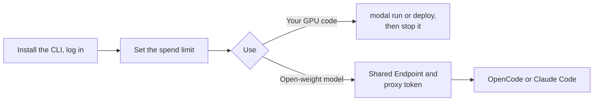

# Modal

Modal gives a Claude Code or OpenCode user serverless GPUs for their own code, plus per-token Shared Endpoints for open-weight models.

| Account | Free tier | Login or key | Claude connector | OpenCode | Guard |
| --- | --- | --- | --- | --- | --- |
| Anyone with a browser sign-in. Whether Starter needs a card is not published. Inviting members needs a payment method ([Workspaces](https://modal.com/docs/guide/workspaces), read 2026-11-12) | Starter: $30 a month of free compute credits and 3 workspace seats ([Plan pricing](https://modal.com/pricing), read 2026-11-12). Shared Endpoint tokens are not covered and bill from the first request ([Plan pricing](https://modal.com/pricing), read 2026-11-12) | `modal setup` (browser login). Shared Endpoints take a proxy token in `MODAL_PROXY_TOKEN` | None. Modal documents hosting your own MCP server, not one of its own | Provider id `modal` in the models.dev catalog, base URL `https://inference.us-west.modal.direct/v1`, env `MODAL_PROXY_TOKEN`. Connect with `/connect` | Workspace spend limit on Usage & Billing: past it, Modal stops workloads that would cost out of pocket ([Budgets](https://modal.com/docs/guide/budgets), read 2026-11-12). Raising it or **Reset to default** removes the cap. [Git Crafter compute rules](https://github.com/SoulCraft-Org/git-crafter/blob/main/rules/compute.md) |



## Set up

1. Install the CLI and log in. The login opens a browser and stores the token for the CLI.

   ```bash
   pip install modal
   modal setup
   modal token info
   ```

2. Set the spend limit before the first run. Open **Settings**, then **Usage & Billing** (https://modal.com/settings/usage). Only Owners and Managers can change it.
3. Read the default first. With no custom value, the spend limit equals the usage limit minus credits ([Budgets](https://modal.com/docs/guide/budgets), read 2026-11-12). Set a lower one if that default is above what you accept.
4. For your own GPU code, run and stop it from the CLI. `modal run` is one run; `modal deploy` keeps an app live until you stop it.
5. For an open-weight model in OpenCode, create a Shared Endpoint and a proxy token. Both bill per token outside the plan credit.

   ```bash
   modal endpoint create --shared --model <org/model>
   modal workspace proxy-tokens create
   ```

6. Join the token ID and secret with a period, and keep the result in your password manager. Set `MODAL_PROXY_TOKEN` from that store in one shell, never in a dotfile. Start OpenCode there with `opencode --standalone`: the shared background service cannot see the variable ([CLI providers](https://opencode.ai/docs/cli/providers), read 2026-11-20).
7. In OpenCode, run `/connect`, pick Modal, then `/models` and pick the endpoint by its hostname ([Endpoint integrations](https://modal.com/docs/guide/endpoint-integrations), read 2026-11-12).
8. Claude Code can use the same gateway through `ANTHROPIC_BASE_URL=https://inference.us-west.modal.direct` and `ANTHROPIC_AUTH_TOKEN`. The endpoint's model must support tool calling ([Endpoint integrations](https://modal.com/docs/guide/endpoint-integrations), read 2026-11-12). Set both per command: they outrank a subscription login ([Authentication](https://code.claude.com/docs/en/iam), read 2026-11-12).

Traps and sources: [Modal traps and sources](detail/modal.md).
