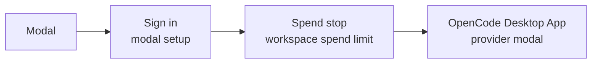

# Modal

Modal gives the OpenCode Desktop App per-token Model APIs for open-weight models. It also runs serverless GPUs for your own code.



| Account | Free tier | Login or key | OpenCode | Guard |
| --- | --- | --- | --- | --- |
| Browser sign-in. Whether Starter needs a card is not published ([Plan pricing](https://modal.com/pricing), read 2026-11-24). | Starter: $30 a month free compute and 3 seats ([Plan pricing](https://modal.com/pricing), read 2026-11-24). Model API tokens bill per token from the first request ([Plan pricing](https://modal.com/pricing), read 2026-11-24). | `modal setup`. Model APIs take a proxy token in `MODAL_PROXY_TOKEN`. | `modal`, base URL `https://inference.us-west.modal.direct/v1` ([models.dev](https://models.dev), read 2026-11-12). | A workspace spend limit stops workloads that cost out of pocket ([Budgets](https://modal.com/docs/guide/budgets), read 2026-11-24). Raising it removes the stop. [Detail](detail/modal.md#guard). See [Git Crafter compute rules](https://github.com/SoulCraft-Org/git-crafter/blob/main/rules/compute.md). |

## Wiring

| Host | Plugs in as | Source |
| --- | --- | --- |
| OpenCode Desktop App | `/connect`, pick Modal, enter the proxy token, then pick your Model API by its hostname with `/models`. | [Endpoint integrations](https://modal.com/docs/guide/endpoint-integrations), read 2026-11-24 |

<details>
<summary>Commands</summary>

```bash
pip install modal
modal setup
modal token info
modal endpoint create --shared --model <org/model>
modal workspace proxy-tokens create
```

</details>

Guard and set up: [Modal detail](detail/modal.md). Traps and sources: [Modal traps and sources](detail/modal-traps.md).
