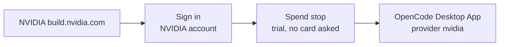

# NVIDIA

NVIDIA gives the OpenCode Desktop App trial access to hosted open-weight models (NIM endpoints) at build.nvidia.com. It also offers a CUDA docs MCP server and GPU containers on NGC.



| Account | Free tier | Login or key | OpenCode | Guard |
| --- | --- | --- | --- | --- |
| Email address; an API key makes you an NVIDIA Developer Program member ([API quickstart](https://docs.api.nvidia.com/nim/docs/api-quickstart), read 2026-11-12). | "Free inference with leading models" ([build.nvidia.com](https://build.nvidia.com/), read 2026-11-24). No credit or rate figure is published. [Detail](detail/nvidia.md#free-tier). | `NVIDIA_API_KEY`. NGC: a Personal API Key. | `nvidia`, base URL `https://integrate.api.nvidia.com/v1` ([models.dev](https://models.dev), read 2026-11-12). | The trial terms allow testing, not production ([API Trial Terms](https://assets.ngc.nvidia.com/products/api-catalog/legal/NVIDIA%20API%20Trial%20Terms%20of%20Service.pdf), read 2026-11-12). A Subscription removes the stop. [Detail](detail/nvidia.md#guard). See [Git Crafter compute rules](https://github.com/SoulCraft-Org/git-crafter/blob/main/rules/compute.md). |

## Wiring

| Host | Plugs in as | Source |
| --- | --- | --- |
| OpenCode Desktop App | Connect provider NVIDIA with a build.nvidia.com key. | [models.dev](https://models.dev), read 2026-11-12 |

<details>
<summary>Commands</summary>

```bash
opencode auth login nvidia --method key
ngc config set
docker login nvcr.io --username '$oauthtoken'
```

Paste each key at its hidden prompt, never on a command line.

</details>

Free tier, guard and set up: [NVIDIA detail](detail/nvidia.md). Traps and sources: [NVIDIA traps and sources](detail/nvidia-traps.md).
