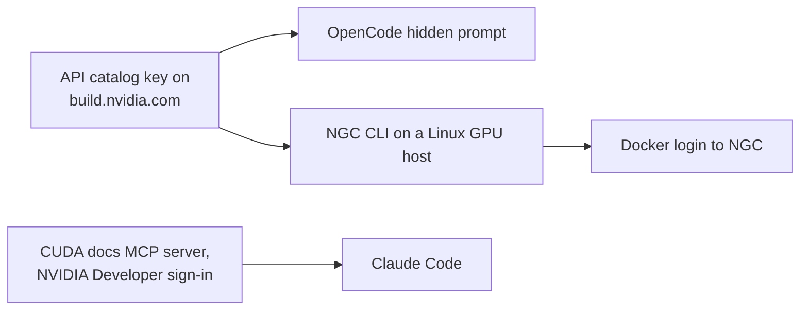

# NVIDIA

NVIDIA gives a Claude Code or OpenCode user trial access to hosted open-weight models (NIM endpoints) at build.nvidia.com, a CUDA docs MCP server, and GPU containers on NGC.

| Account | Free tier | Login or key | Claude connector | OpenCode | Guard |
| --- | --- | --- | --- | --- | --- |
| Anyone with an email address. Signing up for an API key makes you a member of the NVIDIA Developer Program ([API quickstart](https://docs.api.nvidia.com/nim/docs/api-quickstart), read 2026-11-12). | build.nvidia.com offers "Free inference with leading models" ([build.nvidia.com](https://build.nvidia.com/), read 2026-11-12). A credit amount or rate limit: not published on the pages read. The terms allow "internal testing and evaluation purposes, not in production" ([API Trial Terms](https://assets.ngc.nvidia.com/products/api-catalog/legal/NVIDIA%20API%20Trial%20Terms%20of%20Service.pdf), read 2026-11-12). Public NGC containers pull with no sign-in ([NGC Catalog guide](https://docs.nvidia.com/ngc/latest/ngc-catalog-user-guide.html), read 2026-11-12). | API catalog: `NVIDIA_API_KEY`. NGC: `ngc config set` with an NGC Personal API Key. | No MCP server for the API catalog. CUDA docs server: `https://api.copilot.nsight.ngc.nvidia.com/mcp/cuda-docs`, NVIDIA Developer sign-in ([Nsight AI](https://developer.nvidia.com/nsight-ai), read 2026-11-12). | `nvidia`, reads `NVIDIA_API_KEY`, base URL `https://integrate.api.nvidia.com/v1` ([models.dev](https://models.dev), read 2026-11-12). | The quickstart's sign-up steps ask for an email and a password, not a card ([API quickstart](https://docs.api.nvidia.com/nim/docs/api-quickstart), read 2026-11-12). Production use needs a paid Subscription from NVIDIA or a service provider ([API Trial Terms](https://assets.ngc.nvidia.com/products/api-catalog/legal/NVIDIA%20API%20Trial%20Terms%20of%20Service.pdf), read 2026-11-12). Buying one removes the stop. See [Git Crafter compute rules](https://github.com/SoulCraft-Org/git-crafter/blob/main/rules/compute.md). |



## Set up

1. Get an API catalog key. Open any model page on [build.nvidia.com](https://build.nvidia.com/), click **Get API Key**, sign in or create an NVIDIA account, then **Copy Key** ([API quickstart](https://docs.api.nvidia.com/nim/docs/api-quickstart), read 2026-11-12).

2. Connect OpenCode. Paste the key at the hidden prompt, never on a command line ([OpenCode 2](README.md#opencode-2)).

```bash
opencode auth login nvidia --method key
```

Then choose a model with `/models`. Any other OpenAI-compatible tool uses `https://integrate.api.nvidia.com/v1` with the key as a bearer header ([LLM APIs](https://docs.api.nvidia.com/nim/reference/llm-apis), read 2026-11-12).

3. Add NVIDIA's CUDA docs MCP server to Claude Code. It signs in with your NVIDIA Developer account on first connection.

```bash
claude mcp add --scope user --transport http nvidia-cuda-docs https://api.copilot.nsight.ngc.nvidia.com/mcp/cuda-docs
claude mcp login nvidia-cuda-docs
```

4. For NGC containers on a Linux GPU host, install the NGC CLI from the [CLI install page](https://ngc.nvidia.com/setup/installers/cli) ([Getting Started with the NGC CLI](https://docs.ngc.nvidia.com/cli/cmd.html), read 2026-11-12). Then configure it, pasting an NGC Personal API Key at the `API_KEY` prompt.

```bash
ngc config set
ngc config current
```

5. Log Docker in to NGC's registry. `$oauthtoken` is a literal user name; paste the key at the Password prompt ([NGC Catalog guide](https://docs.nvidia.com/ngc/latest/ngc-catalog-user-guide.html), read 2026-11-12).

```bash
docker login nvcr.io --username '$oauthtoken'
```

Traps and sources: [NVIDIA traps and sources](detail/nvidia.md).
