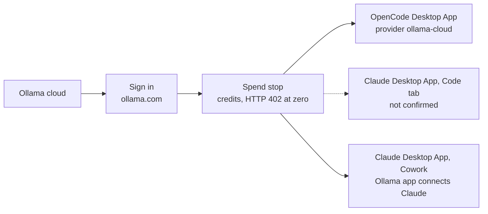

# Ollama

Ollama gives the OpenCode Desktop App and the Claude Desktop App open-weight models in Ollama's cloud, paid per token from usage credits. This guide uses cloud models only, by their `:cloud` names.



| Account | Free tier | Login or key | Claude connector | OpenCode | Guard |
| --- | --- | --- | --- | --- | --- |
| One account per person, signed in at ollama.com ([Pricing](https://ollama.com/pricing), read 2026-11-20). | Pay as you go: $0 a month, 3 concurrent requests, no cloud usage ([Pricing](https://ollama.com/pricing), read 2026-11-20). [Plans](#plans). | `ollama signin`. Direct API calls: `OLLAMA_API_KEY` ([Creating an API key](https://docs.ollama.com/cloud/api), read 2026-11-20). | None hosted. The Ollama app connects the Claude Desktop App on macOS ([Claude Desktop](https://docs.ollama.com/integrations/claude-desktop), read 2026-11-24). | `ollama-cloud`, which reads `OLLAMA_API_KEY` ([models.dev](https://models.dev), read 2026-11-24). | Spends only credits. Team's automatic usage billing removes the stop ([Pricing](https://ollama.com/pricing), read 2026-11-20). [Guard detail](detail/ollama.md#guard). See [Git Crafter compute rules](https://github.com/SoulCraft-Org/git-crafter/blob/main/rules/compute.md). |

## Wiring

| Host | Plugs in as | Source, read 2026-11-24 |
| --- | --- | --- |
| OpenCode Desktop App | Ollama's page names OpenCode. The catalog lists `ollama-cloud`, key `OLLAMA_API_KEY`. No Desktop connect screen is shown for it. | [Ollama: OpenCode](https://docs.ollama.com/integrations/opencode), [OpenCode providers](https://opencode.ai/docs/providers), [models.dev](https://models.dev) |
| Claude Desktop App, Code tab | Not confirmed. Ollama's page names no tab. The app ignores `ANTHROPIC_BASE_URL` in local sessions. | [Ollama Claude Desktop](https://docs.ollama.com/integrations/claude-desktop), [Desktop docs](https://code.claude.com/docs/en/desktop) |
| Claude Desktop App, Cowork | Ollama app, Apps, Connect Claude, macOS only. Ollama lists Cowork as supported. | [Ollama Claude Desktop](https://docs.ollama.com/integrations/claude-desktop) |

## Plans

| Plan | Price | Included usage credits | Concurrent requests | Source |
| --- | --- | --- | --- | --- |
| Pay as you go | $0, no subscription | None | 3 | [Pricing](https://ollama.com/pricing), read 2026-11-20 |
| Pro | $20 a month, or $200 a year | $60 a month | 3 | [Pricing](https://ollama.com/pricing), read 2026-11-20 |
| Max | $100 a month | $300 a month | 10 | [Pricing](https://ollama.com/pricing), read 2026-11-20 |

Included usage resets monthly on the subscription's start day and does not roll over ([Pricing](https://ollama.com/pricing), read 2026-11-20). [catalog/plans.json](../catalog/plans.json) holds each plan as a row.

<details>
<summary>Commands</summary>

```bash
ollama signin
ollama launch opencode
curl -s https://ollama.com/api/balance -H "Authorization: Bearer $OLLAMA_API_KEY"
```

</details>

Guard, set-up steps, traps and sources: [Ollama traps and sources](detail/ollama.md).
