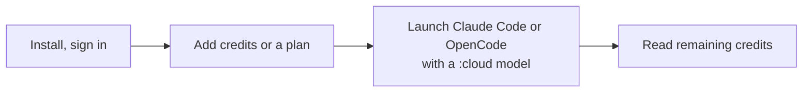

# Ollama

Ollama gives a Claude Code or OpenCode user open-weight models in Ollama's cloud, paid per token from usage credits. This guide uses cloud models only, by their `:cloud` names.

| Account | Free tier | Login or key | Claude connector | OpenCode | Guard |
| --- | --- | --- | --- | --- | --- |
| One account per person, with a sign-in at ollama.com ([Pricing](https://ollama.com/pricing), read 2026-11-20). | Pay as you go costs $0 a month, with no subscription and 3 concurrent requests ([Pricing](https://ollama.com/pricing), read 2026-11-20). It includes no cloud usage: Pay as you go accounts pay for each request with usage credits ([Pricing](https://ollama.com/pricing), read 2026-11-20). | `ollama signin` for the app and CLI. For direct calls to `https://ollama.com/api`, `OLLAMA_API_KEY` from a key made in settings ([Creating an API key](https://docs.ollama.com/cloud/api), read 2026-11-20). | None hosted. Claude Code uses Ollama's Anthropic-compatible API: `ollama launch claude`, or base URL `https://ollama.com` ([Claude Code](https://docs.ollama.com/integrations/claude-code), read 2026-11-20). | `ollama-cloud`, which reads `OLLAMA_API_KEY` ([models.dev](https://models.dev), read 2026-11-20). | Cloud requests spend only credits. Ollama uses included plan credits first, then purchased credits ([Pricing](https://ollama.com/pricing), read 2026-11-20). With neither, a cloud request returned HTTP 402 "Add usage credits or subscribe" in a test on 2026-11-20. Buying credits raises the stop by their amount. Team's automatic usage billing removes it ([Pricing](https://ollama.com/pricing), read 2026-11-20). See [Git Crafter compute rules](https://github.com/SoulCraft-Org/git-crafter/blob/main/rules/compute.md). |



## Plans

| Plan | Price | Included usage credits | Concurrent requests | Source |
| --- | --- | --- | --- | --- |
| Pay as you go | $0 | None | 3 | [Pricing](https://ollama.com/pricing), read 2026-11-20 |
| Pro | $20 a month, or $200 a year | $60 a month | 3 | [Pricing](https://ollama.com/pricing), read 2026-11-20 |
| Max | $100 a month | $300 a month | 10 | [Pricing](https://ollama.com/pricing), read 2026-11-20 |

Included usage resets monthly on the subscription's start day and does not roll over ([Pricing](https://ollama.com/pricing), read 2026-11-20). [catalog/plans.json](../catalog/plans.json) holds each plan as a row.

## Set up

1. Install Ollama from [ollama.com/download](https://ollama.com/download), then sign in through the browser ([Models](https://docs.ollama.com/cloud/models), read 2026-11-20).

```bash
ollama signin
```

2. Add usage credits or a plan on ollama.com first. Cloud models need them.

3. Start Claude Code or OpenCode through Ollama, and pick a model by its `:cloud` name, such as `gemma4:cloud` ([Models](https://docs.ollama.com/cloud/models), read 2026-11-20). Each command sets the base URL for you ([Claude Code](https://docs.ollama.com/integrations/claude-code), [OpenCode](https://docs.ollama.com/integrations/opencode), read 2026-11-20).

```bash
ollama launch claude
```

```bash
ollama launch opencode
```

4. Read your remaining included and purchased credits before a long run. The command names the variable; your shell supplies the key from your secret store ([Usage](https://docs.ollama.com/cloud/usage), read 2026-11-20).

```bash
curl -s https://ollama.com/api/balance -H "Authorization: Bearer $OLLAMA_API_KEY"
```

Traps and sources: [Ollama traps and sources](detail/ollama.md).
