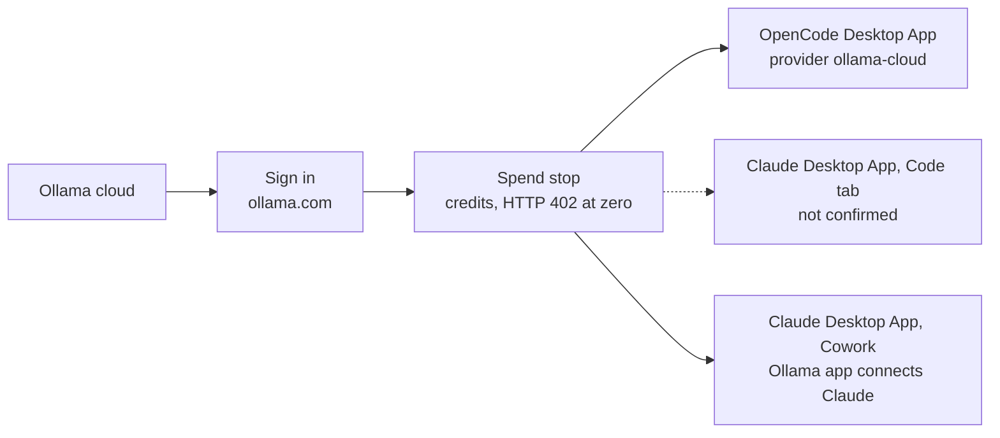

# Ollama

Ollama gives the OpenCode Desktop App and the Claude Desktop App open-weight models in Ollama's cloud, paid per token from usage credits. This guide uses cloud models only, by their `:cloud` names.



| Account | Free tier | Login or key | Claude connector | OpenCode | Guard |
| --- | --- | --- | --- | --- | --- |
| One account per person, with a sign-in at ollama.com ([Pricing](https://ollama.com/pricing), read 2026-11-20). | Pay as you go costs $0 a month, with no subscription and 3 concurrent requests ([Pricing](https://ollama.com/pricing), read 2026-11-20). It includes no cloud usage: each request spends usage credits. Plans: [Ollama plans](detail/ollama.md#plans). | `ollama signin` for the app and CLI. For direct calls to `https://ollama.com/api`, `OLLAMA_API_KEY` from a key made in settings ([Creating an API key](https://docs.ollama.com/cloud/api), read 2026-11-20). | None hosted. The Ollama app connects the Claude Desktop App on macOS ([Claude Desktop](https://docs.ollama.com/integrations/claude-desktop), read 2026-11-24). The Claude Code CLI uses `ollama launch claude`, or base URL `https://ollama.com` ([Claude Code](https://docs.ollama.com/integrations/claude-code), read 2026-11-24). | `ollama-cloud`, which reads `OLLAMA_API_KEY` ([models.dev](https://models.dev), read 2026-11-24). | Cloud requests spend only credits: included plan credits first, then purchased ones ([Pricing](https://ollama.com/pricing), read 2026-11-20). With neither, a cloud request returned HTTP 402 "Add usage credits or subscribe" in a test on 2026-11-20. Buying credits raises the stop by their amount. Team's automatic usage billing removes it. See [Git Crafter compute rules](https://github.com/SoulCraft-Org/git-crafter/blob/main/rules/compute.md). |

## Wiring

| Host | Plugs in as | Source, read 2026-11-24 |
| --- | --- | --- |
| OpenCode Desktop App | Connect provider `ollama-cloud`, key `OLLAMA_API_KEY`. | [OpenCode providers](https://opencode.ai/docs/providers), [models.dev](https://models.dev) |
| Claude Desktop App, Code tab | Not confirmed. Ollama's page names no tab. The app ignores `ANTHROPIC_BASE_URL` in local sessions. | [Ollama Claude Desktop](https://docs.ollama.com/integrations/claude-desktop), [Desktop docs](https://code.claude.com/docs/en/desktop) |
| Claude Desktop App, Cowork | Ollama app, Apps, Connect Claude, macOS only. Ollama lists Cowork as supported. | [Ollama Claude Desktop](https://docs.ollama.com/integrations/claude-desktop) |

<details>
<summary>Commands</summary>

```bash
ollama signin
ollama launch opencode
ollama launch claude
curl -s https://ollama.com/api/balance -H "Authorization: Bearer $OLLAMA_API_KEY"
```

</details>

Set-up steps, traps and sources: [Ollama traps and sources](detail/ollama.md).
