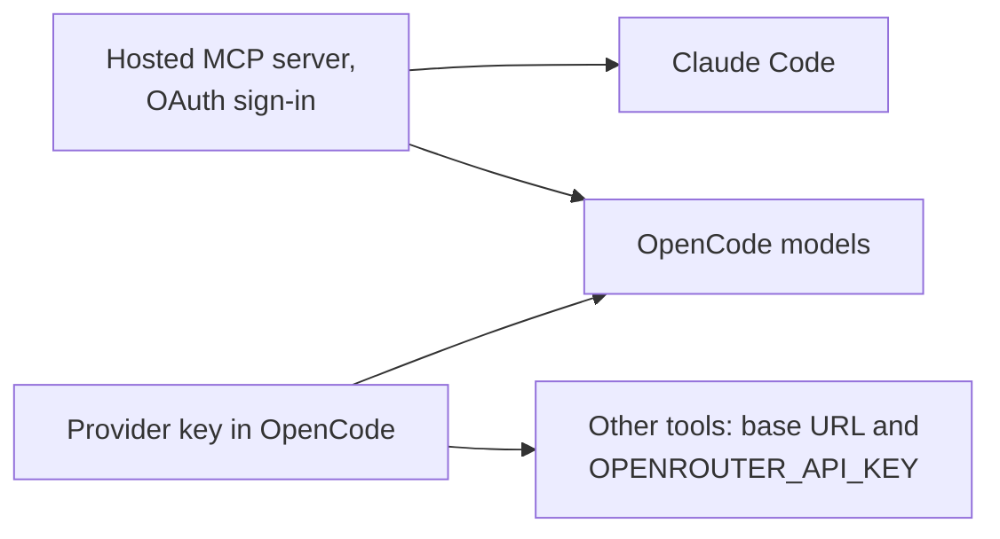

# OpenRouter

OpenRouter gives a Claude Code or OpenCode user one OpenAI-compatible API over many vendors' models, including `:free` open-weight variants.

| Account | Free tier | Login or key | Claude connector | OpenCode | Guard |
| --- | --- | --- | --- | --- | --- |
| Anyone with an email; credits are bought by card (5.5% fee, $0.80 minimum) or crypto (5% fee) ([Frequently Asked Questions](https://openrouter.ai/docs/faq), read 2026-11-12). | Model IDs ending in `:free`: 20 requests per minute, and 50 requests per day with under 10 credits bought all time ([Limits](https://openrouter.ai/docs/api/reference/limits), read 2026-11-12). At least 10 credits bought raises the daily cap to 1000 ([Limits](https://openrouter.ai/docs/api/reference/limits), read 2026-11-12). | OAuth through the MCP server or `/connect`; else `OPENROUTER_API_KEY`. | `https://mcp.openrouter.ai/mcp` ([MCP](https://openrouter.ai/docs/guides/overview/mcp-server), read 2026-11-12). | `openrouter`, built in ([OpenCode providers](https://opencode.ai/docs/providers), read 2026-11-12). | Credits are prepaid; a key can carry its own credit limit ([Management API Keys](https://openrouter.ai/docs/guides/overview/auth/provisioning-api-keys), read 2026-11-12). Turning on auto top-up removes the stop. See [Git Crafter compute rules](https://github.com/SoulCraft-Org/git-crafter/blob/main/rules/compute.md). |



## Set up

1. Add the hosted MCP server to Claude Code and sign in with OAuth.

```bash
claude mcp add --transport http openrouter https://mcp.openrouter.ai/mcp
claude mcp login openrouter
```

The login creates a dedicated key that expires within 7 days and starts with a $10 spend cap ([MCP](https://openrouter.ai/docs/guides/overview/mcp-server), read 2026-11-12). Lower the cap on the approval screen if you only use `:free` models.

2. Connect OpenRouter as a model provider in OpenCode.

```bash
opencode auth login openrouter
```

Pick a method, then run `/models` inside OpenCode. A key goes in at the hidden prompt, never on the command line ([OpenCode 2](README.md#opencode-2)). A model reference is the provider prefix plus the full OpenRouter ID, such as `openrouter/<vendor>/<model>:free`.

3. Add the same MCP server to OpenCode, if you want its tools there. OpenCode 2 lists servers under `mcp.servers` ([MCP servers](https://opencode.ai/docs/mcp-servers), read 2026-11-20). Put this in `~/.config/opencode/opencode.jsonc`; OpenCode runs the OAuth flow on first use.

```json
{
  "mcp": {
    "servers": {
      "openrouter": { "type": "remote", "url": "https://mcp.openrouter.ai/mcp" }
    }
  }
}
```

4. Any other OpenAI-compatible tool uses base URL `https://openrouter.ai/api/v1` with `OPENROUTER_API_KEY` set in its environment ([Quickstart](https://openrouter.ai/docs/quickstart), read 2026-11-12).

Traps and sources: [OpenRouter traps and sources](detail/openrouter.md).
