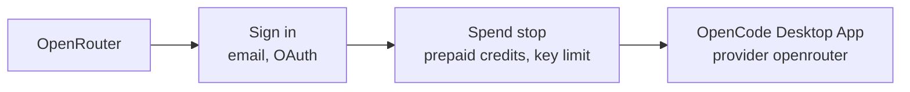

# OpenRouter

OpenRouter gives the OpenCode Desktop App one OpenAI-compatible API over many vendors' models, including `:free` open-weight variants.



| Account | Free tier | Login or key | OpenCode | Guard |
| --- | --- | --- | --- | --- |
| Anyone with an email; credits by card (5.5% fee, $0.80 minimum) or crypto (5% fee) ([Frequently Asked Questions](https://openrouter.ai/docs/faq), read 2026-11-12). | `:free` model IDs: 20 requests a minute; 50 a day under 10 credits bought, 1000 a day from 10 ([Limits](https://openrouter.ai/docs/api/reference/limits), read 2026-11-12). | OAuth through the MCP server or `/connect`; else `OPENROUTER_API_KEY`. | `openrouter`, built in ([OpenCode providers](https://opencode.ai/docs/providers), read 2026-11-24). | Prepaid credits; a key can carry a limit ([Management API Keys](https://openrouter.ai/docs/guides/overview/auth/provisioning-api-keys), read 2026-11-12). Auto top-up removes the stop. See [Git Crafter compute rules](https://github.com/SoulCraft-Org/git-crafter/blob/main/rules/compute.md). |

## Wiring

| Host | Plugs in as | Source, read 2026-11-24 |
| --- | --- | --- |
| OpenCode Desktop App | Settings, Providers, OpenRouter, Connect, API key. Both OpenCode apps share one stored credential. The MCP server is optional, under `mcp.servers`. | [OpenRouter: OpenCode](https://openrouter.ai/docs/cookbook/coding-agents/opencode-integration), [OpenCode MCP servers](https://opencode.ai/docs/mcp-servers) |

<details>
<summary>Commands</summary>

```bash
opencode auth login openrouter
```

```json
{ "mcp": { "servers": { "openrouter": { "type": "remote", "url": "https://mcp.openrouter.ai/mcp" } } } }
```

</details>

Set-up notes, traps and sources: [OpenRouter traps and sources](detail/openrouter.md).
