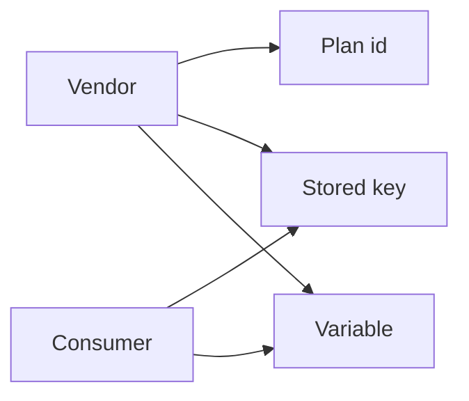

# Names

Three parts name every plan, stored key and variable: the vendor, the plan and the consumer. [CHECKLIST.md](../CHECKLIST.md) uses them for each new provider.

| Name | Pattern | Example | Rule |
| --- | --- | --- | --- |
| Vendor | A lowercase slug | `groq` | The prefix of the vendor's plan ids in the catalog |
| Plan id | `<vendor>-<plan>` | `groq-free` | The catalog's `id` field ([catalog/README.md](../../catalog/README.md)) |
| Consumer | A lowercase slug for the tool or job that uses the key | `ci`, `nightly-eval` | One key per consumer, so revoking one leaves the others working |
| Stored key | `<vendor>:<consumer>` | `groq:ci` | The name in your secret store. The value never appears in a file, a command or a log |
| Variable | `<CONSUMER>_<VENDOR>_API_KEY`, upper case, `-` as `_` | `CI_GROQ_API_KEY`, `NIGHTLY_EVAL_GROQ_API_KEY` | Load it from the stored key at launch, never from a dotfile |
| Fixed variable | The tool's own name | `GROQ_API_KEY` in OpenCode's catalog ([models.dev](https://models.dev), read 2026-11-20) | Some tools fix the name. Load the stored key into it for one process only |
