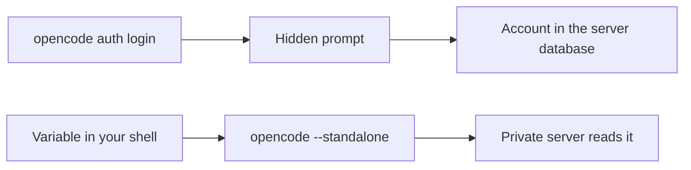

# OpenCode 2 rules

Every guide's OpenCode step follows these rules, read on OpenCode's own pages on 2026-11-20 and checked against `opencode` v2.3.2.

| Topic | Rule | Source |
| --- | --- | --- |
| Key store | `opencode auth login` saves an API key or OAuth token as an account in the server's SQLite database, usually `~/.local/share/opencode/opencode.db`. OpenCode 2 imports a legacy `auth.json` once and never writes that file again | [CLI providers](https://opencode.ai/docs/cli/providers) |
| Key entry | `opencode auth login <provider> --method key` asks for the key at a hidden prompt, in an interactive terminal. Method IDs are provider-specific: drop `--method` to pick from a list | [CLI providers](https://opencode.ai/docs/cli/providers) |
| Never `--answer` | `--answer key=value` fills a provider form from the command line, so a key there lands in shell history and the process list | `opencode auth login --help` |
| Background service | OpenCode starts one shared server per user, and every client uses it, `opencode run` included. A variable reaches only the server process, so a key in your shell is invisible to the shared service | [CLI](https://opencode.ai/docs/cli), [CLI providers](https://opencode.ai/docs/cli/providers) |
| Keys from the environment | Start a private server from the shell that holds the variable: `opencode --standalone`. Never give a key to `opencode service set env NAME value`: it takes the value as an argument. A value that is not a secret, such as an account ID, is fine there | [CLI providers](https://opencode.ai/docs/cli/providers) |
| `{env:VAR}` | A config value `"{env:VAR}"` reads a variable; an unset one becomes an empty string. The server owns configuration, so pair a variable with `--standalone` | [Config](https://opencode.ai/docs/config), [CLI](https://opencode.ai/docs/cli) |
| Updates | Set `"update": "disable"` in the global config when a package manager owns the install. The default, `"notify"`, shows each update before installing it. Project-level values are ignored | [Config](https://opencode.ai/docs/config) |
| `auth export` | `opencode auth export` prints every stored credential, secrets included, as JSON. Never run it where a log or a screen share can read it | `opencode auth --help` |
| Config shape | V2 lists providers under `providers`, with `package` and `settings`, and MCP servers under `mcp.servers`. V1's `provider`, `npm` and `options` still load | [Migrate from V1](https://opencode.ai/docs/migrate-v1) |
