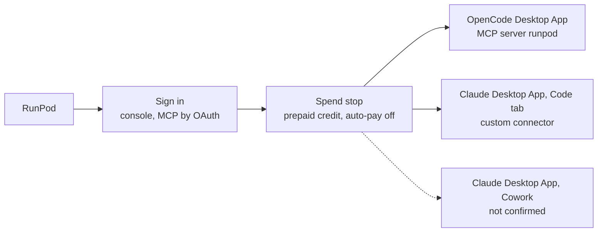

# RunPod

RunPod rents GPU pods and Serverless endpoints by the second. Its hosted MCP server lets the OpenCode Desktop App and the Claude Desktop App manage them.



| Account | Free tier | Login or key | Claude connector | OpenCode | Guard |
| --- | --- | --- | --- | --- | --- |
| Anyone with a verified email. Deploying needs a payment method and credits ([Get started](https://docs.runpod.io/get-started), read 2026-11-24). | None published. Prepaid credit, billed per second ([Pricing](https://www.runpod.io/pricing), read 2026-11-24). | MCP: "Sign in with Runpod" (OAuth). CLI: `runpodctl doctor` prompts for a key. | `https://mcp.runpod.io/` ([MCP servers](https://docs.runpod.io/get-started/mcp-servers), read 2026-11-24). | Remote MCP server. Not a built-in model provider. | At zero balance pods stop; default limit $80 an hour ([Billing](https://docs.runpod.io/accounts-billing/billing), read 2026-11-24). Auto-pay removes the stop. [Guard detail](detail/runpod.md#guard). See [Git Crafter compute rules](https://github.com/SoulCraft-Org/git-crafter/blob/main/rules/compute.md). |

## Wiring

| Host | Plugs in as | Source, read 2026-11-24 |
| --- | --- | --- |
| OpenCode Desktop App | Remote MCP server `runpod` under `mcp`, then `opencode mcp auth runpod`. A Serverless vLLM endpoint is OpenAI-compatible, so it fits a custom provider. | [RunPod MCP servers](https://docs.runpod.io/get-started/mcp-servers), [vLLM compatibility](https://docs.runpod.io/serverless/vllm/openai-compatibility), [OpenCode providers](https://opencode.ai/docs/providers) |
| Claude Desktop App, Code tab | Add custom connector `https://mcp.runpod.io/` (RunPod). Connectors added with the plus button reach local Code sessions (Desktop docs). | [RunPod MCP servers](https://docs.runpod.io/get-started/mcp-servers), [Desktop docs: Connect external tools](https://code.claude.com/docs/en/desktop) |
| Claude Desktop App, Cowork | Not confirmed. RunPod's page does not mention Cowork. Cowork takes connectors from your claude.ai account. | [RunPod MCP servers](https://docs.runpod.io/get-started/mcp-servers), [Desktop docs](https://code.claude.com/docs/en/desktop) |

<details>
<summary>Commands</summary>

```bash
opencode mcp add runpod --global --url https://mcp.runpod.io/
opencode mcp auth runpod
opencode mcp list
opencode mcp add runpod-docs --global --url https://docs.runpod.io/mcp
brew install runpod/runpodctl/runpodctl
runpodctl doctor
runpodctl pod stop <pod_id>
runpodctl pod delete <pod_id>
```

</details>

Guard and set up: [RunPod detail](detail/runpod.md). Traps and sources: [RunPod traps and sources](detail/runpod-traps.md).
