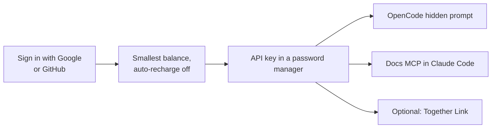

# Together AI

Together AI gives a Claude Code or OpenCode user prepaid, pay-per-token access to hosted open-weight models, an OpenAI-compatible API, and Together Link to run coding agents on those models.

| Account | Free tier | Login or key | Claude connector | OpenCode | Guard |
| --- | --- | --- | --- | --- | --- |
| Anyone with a Google or GitHub account; Together signs in only through OAuth ([Account management](https://docs.together.ai/docs/account-management), read 2026-11-12). | None: "Together AI does not currently offer free trials" ([Billing and credits](https://docs.together.ai/docs/billing-credits), read 2026-11-12). The first purchase is at least $15, and later ones at least $5 ([Billing and credits](https://docs.together.ai/docs/billing-credits), read 2026-11-12). Prepaid credits do not expire. | `TOGETHER_API_KEY` ([OpenAI compatibility](https://docs.together.ai/docs/openai-api-compatibility), read 2026-11-12). Together Link stores it with `togetherlink configure`. | Docs only: `https://docs.together.ai/mcp` ([Coding agent setup](https://docs.together.ai/docs/mcp), read 2026-11-12). | `togetherai`, reads `TOGETHER_API_KEY` ([models.dev](https://models.dev), read 2026-11-12). OpenAI-compatible base URL `https://api.together.ai/v1`. | Prepaid: "If your balance reaches zero, API access is suspended until you add credits" ([Billing and credits](https://docs.together.ai/docs/billing-credits), read 2026-11-12). Turning on auto-recharge removes the stop; it "does not cap spend" ([Spend controls](https://docs.together.ai/docs/billing-spend-controls), read 2026-11-12). See [Git Crafter compute rules](https://github.com/SoulCraft-Org/git-crafter/blob/main/rules/compute.md). |



## Set up

1. Sign in at [api.together.ai](https://api.together.ai/signin) with Google or GitHub. Pick the one you will keep; Together cannot switch it later.

2. Buy the smallest balance you need, and leave auto-recharge off. A purchase is spend, so clear it under your own money rule first.

3. Create an API key in Together's settings. Keep it in a password manager, never in a repo or a shell profile.

4. Connect OpenCode. Paste the key at the hidden prompt ([OpenCode 2](README.md#opencode-2)).

```bash
opencode auth login togetherai --method key
```

Pick Together AI, then choose a model with `/models`. Any other OpenAI-compatible tool uses base URL `https://api.together.ai/v1` ([OpenAI compatibility](https://docs.together.ai/docs/openai-api-compatibility), read 2026-11-12).

5. Add Together's docs MCP server to Claude Code. It searches Together's documentation and runs no models.

```bash
claude mcp add --transport http TogetherAIDocs https://docs.together.ai/mcp
```

6. Optional: run Claude Code or OpenCode itself on Together models with Together Link, a beta CLI ([Together Link](https://docs.together.ai/docs/togetherlink), read 2026-11-12). `configure` validates the key at a prompt before it stores it.

```bash
curl -fsSL https://link.together.ai/install | bash
togetherlink configure
togetherlink opencode
togetherlink claude
```

Each launch uses a temporary config and leaves your normal config files alone.

Traps and sources: [Together AI traps and sources](detail/together.md).
