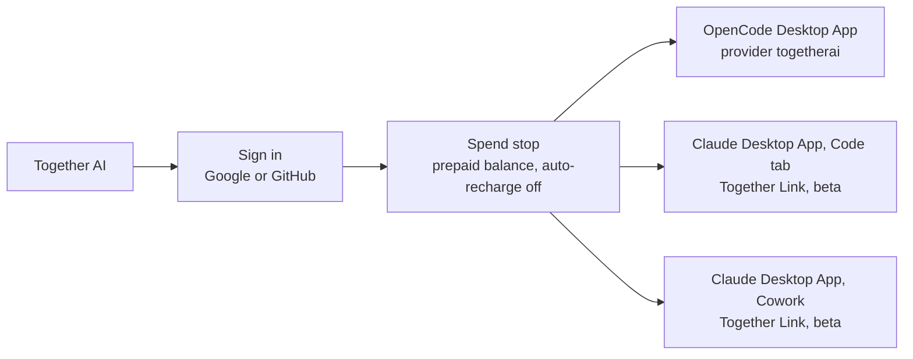

# Together AI

Together AI gives the OpenCode Desktop App and the Claude Desktop App prepaid, pay-per-token open-weight models. Together Link runs the Claude Desktop App on those models.



| Account | Free tier | Login or key | Claude connector | OpenCode | Guard |
| --- | --- | --- | --- | --- | --- |
| Google or GitHub sign-in only ([Account management](https://docs.together.ai/docs/account-management), read 2026-11-12). | None: "Together AI doesn't currently offer free trials." ([Billing and credits](https://docs.together.ai/docs/billing-credits), read 2026-11-24). | `TOGETHER_API_KEY`. Together Link stores it with `togetherlink configure`. | Docs-only MCP: `https://docs.together.ai/mcp` ([Docs MCP](https://docs.together.ai/docs/mcp), read 2026-11-24). | `togetherai` ([models.dev](https://models.dev), read 2026-11-12). | At zero balance, access is suspended ([Billing and credits](https://docs.together.ai/docs/billing-credits), read 2026-11-24). Auto-recharge removes the stop. [Detail](detail/together.md#guard). See [Git Crafter compute rules](https://github.com/SoulCraft-Org/git-crafter/blob/main/rules/compute.md). |

## Wiring

| Host | Plugs in as | Source |
| --- | --- | --- |
| OpenCode Desktop App | Connect provider Together AI with a key. Together Link also launches OpenCode 2. | [models.dev](https://models.dev), read 2026-11-12; [Together Link](https://docs.together.ai/docs/togetherlink), read 2026-11-24 |
| Claude Desktop App, Code tab | Together Link's Claude Desktop mode, beta on macOS and Linux. The docs MCP page names no Desktop App. | [Together Link](https://docs.together.ai/docs/togetherlink), [Docs MCP](https://docs.together.ai/docs/mcp), read 2026-11-24 |
| Claude Desktop App, Cowork | The same mode: Together's page says it covers Cowork and Code. | [Together Link](https://docs.together.ai/docs/togetherlink), read 2026-11-24 |

<details>
<summary>Commands</summary>

```bash
opencode auth login togetherai --method key
curl -fsSL https://link.together.ai/install | bash
togetherlink configure
togetherlink opencode
togetherlink claude-desktop
```

</details>

Guard and set up: [Together AI detail](detail/together.md). Traps and sources: [Together AI traps and sources](detail/together-traps.md).
