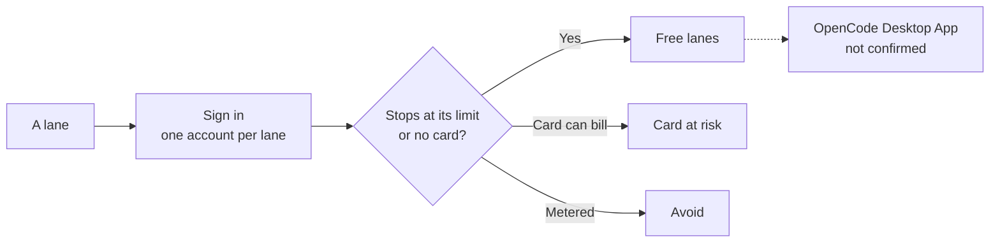

# Training an open model on free and subscription credits

How to fine-tune an open-weight model with LoRA, then improve it with reinforcement learning such as GRPO, without a pay-per-use bill. Every figure is from the vendor's own page with its read date. The plan rows are in [catalog/plans.json](../catalog/plans.json).



The rule: a lane counts as free only when it stops at its limit or never takes a card. A lane that can bill a card without a verified stop is never presented as free.

| Page | Holds |
| --- | --- |
| [Jobs by GPU size](training/jobs.md) | Which job fits which card, and the order of work |
| [Free lanes](training/free-lanes.md) | Hugging Face Jobs, Google AI Pro for Colab, Kaggle Notebooks, Hugging Face ZeroGPU |
| [Card at risk](training/card-at-risk.md) | Modal Starter, AMD Developer Cloud, Lightning AI |
| [Avoid](training/avoid.md) | Lanes that bill without a verified stop, and every page read for this guide |

## Wiring

| Host | Plugs in as | Source, read 2026-11-24 |
| --- | --- | --- |
| OpenCode Desktop App | No page read names this host. | [HF Jobs pricing](https://huggingface.co/docs/hub/jobs-pricing) |

<details>
<summary>Commands</summary>

```bash
hf jobs hardware
hf jobs run --timeout 3h ...
hf jobs cancel <job-id>
```

</details>

A lane's own traps are on its page: [Modal](modal.md), [AMD](amd.md), [Hugging Face](hugging-face.md).
