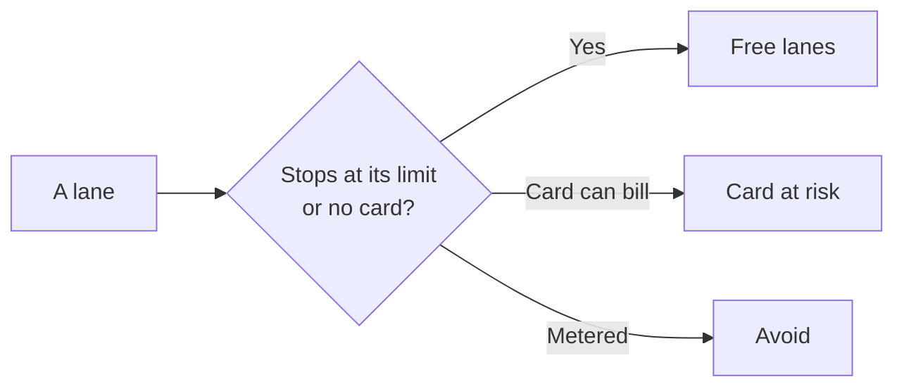

# Training an open model on free and subscription credits

How to fine-tune an open-weight model with LoRA, then improve it with reinforcement learning such as GRPO, without a pay-per-use bill. Every figure is from the vendor's own page, read on 2026-11-23, unless a cell says otherwise. The plan rows are in [catalog/plans.json](../catalog/plans.json).

The rule: a lane counts as free only when it stops at its limit or never takes a card. A lane that can bill a card without a verified stop is never presented as free.

| Page | Holds |
| --- | --- |
| [Free lanes](training/free-lanes.md) | Hugging Face Jobs, Google AI Pro for Colab, Kaggle Notebooks, Hugging Face ZeroGPU |
| [Card at risk](training/card-at-risk.md) | Modal Starter, AMD Developer Cloud, Lightning AI |
| [Avoid](training/avoid.md) | Lanes that bill without a verified stop, and every page read for this guide |

## Jobs by GPU size

Memory sizes are the vendor's listed GPU memory. Which job fits which size is a rule of thumb, not a vendor figure. Check your own model, context length and batch size.

| Job | GPU memory | Hardware on a lane | Notes |
| --- | --- | --- | --- |
| Evaluation, small-model smoke tests | 24 GB | 1x L4 24 GB, $0.80 an hour on Hugging Face Jobs ([Jobs pricing](https://huggingface.co/docs/hub/jobs-pricing)). | Run the eval before and after every training run. |
| LoRA, mid-size model | 48 to 80 GB | L40S 48 GB is $1.80 an hour, A100 large 80 GB $2.50 on Hugging Face Jobs ([Jobs pricing](https://huggingface.co/docs/hub/jobs-pricing)). L40S, A100 80 GB and H100 per-second prices on [Modal](https://modal.com/pricing). | Use a 4-bit or 8-bit base to stay in the smaller card. |
| Single-GPU RL (GRPO) | 80 GB | A100 large 80 GB, $2.50 an hour ([Jobs pricing](https://huggingface.co/docs/hub/jobs-pricing)). A100 80 GB at $0.000694 a second on [Modal](https://modal.com/pricing). | RL holds the policy, the rollouts and often a reference model at once, so give it the largest card you have. |
| A 27B model | 96 GB or more | RTX PRO 6000 96 GB, $2.75 an hour ([Jobs pricing](https://huggingface.co/docs/hub/jobs-pricing)). H200 141 GB, $5.00 an hour per the same page. | At these prices a monthly credit buys about an hour. Plan for one short run. |

## Order of work

1. Evaluate the base model on the 24 GB lane and keep the score.
2. Train a LoRA adapter on a 48 to 80 GB card. Save the adapter to the Hugging Face Hub at each step, since a lane can end a session without warning.
3. Run GRPO from that adapter on an 80 GB card, with short rollouts.
4. Evaluate again and compare with step 1.
5. Cancel the Job or stop the app the same day. See the traps pages linked from [Modal](modal.md) and [AMD](amd.md).
