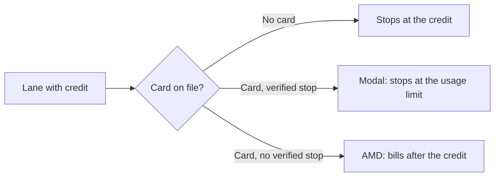

# Training lanes with a card at risk

Lanes that give credit but can bill a card once it is on file. Use them only with no card attached, or with a limit you have checked yourself. Every figure is from the vendor's own page, read on 2026-11-23, unless a cell says otherwise. The rule is in [Training](../training.md).

## Modal Starter

Modal needs a card, and a limit you set is its stop.

| Lane | How much | Commercial use | Your data trains their models | How the card stays uncharged |
| --- | --- | --- | --- | --- |
| [Modal](https://modal.com/pricing) Starter | $30 of compute credit a month. Early-stage startups can ask for credits, and academics for up to $10k, with no amount stated for startups ([Modal pricing](https://modal.com/pricing), read 2026-11-23). | Not stated on the pages read. | Not stated on the pages read. | Using a GPU needs a payment method on file. Set the workspace usage limit equal to the monthly credit before the first run. A spend limit is "a monthly cap on net charges". The default spend limit is the usage limit minus credits. At the spend limit "Modal stops workloads that would incur additional out-of-pocket charges" ([Budgets](https://modal.com/docs/guide/budgets), read 2026-11-23). The page gives no minimum usage limit, so confirm the console accepts it. Whether volume storage bills past the limit is unverified, and storage is billed ([Volumes](https://modal.com/docs/guide/volumes), read 2026-11-23). See [Modal](../modal.md). |

## No verified stop

These lanes can bill a card once it is on file, and no verified stop is documented.

| Lane | How much | Why the card is at risk |
| --- | --- | --- |
| [AMD Developer Cloud](https://www.amd.com/en/developer/resources/technical-articles/2026/how-to-claim-amd-cloud-credits.html) | Free credit for AMD AI Developer Program members, requested through Member Perks and approved in 2 to 3 business days. It runs on bare-metal Instinct GPUs. Credits expire 30 days after activation ([AMD article](https://www.amd.com/en/developer/resources/technical-articles/2026/how-to-claim-amd-cloud-credits.html), read 2026-11-23). The amount is on the [AMD guide](../amd.md). | With no payment method on file the VM and its data are destroyed at expiry. A card on file means billing after the credit ([AMD guide](../amd.md), read 2026-11-12). Needs a ROCm build of your trainer. |

Lightning AI is unconfirmed and not recommended. Its pricing page names up to 30 starting credits ([Lightning pricing](https://lightning.ai/pricing), read 2026-11-23). It says nothing verified about what happens at zero credits, and its billing docs returned HTTP 403. Its catalog rows stay `verified: false`.
