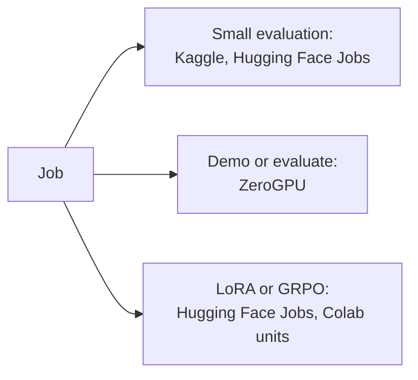

# Training lanes that give GPU time for free

Lanes that give GPU time free or inside a flat plan. Each row stops at its limit or takes no card. Every figure is from the vendor's own page, read on 2026-11-23, unless a cell says otherwise. The rule is in [Training](../training.md). The jobs are in [Training jobs by GPU size](jobs.md).

| Lane | How much | Commercial use | Your data trains their models | How the card stays uncharged |
| --- | --- | --- | --- | --- |
| [Hugging Face Jobs](https://huggingface.co/docs/hub/jobs-pricing) with PRO ($9 a month) | PRO lists $2 of monthly usage ([PRO](https://huggingface.co/pro), read 2026-11-23). The PRO docs say the included monthly credits can be spent on Jobs ([PRO docs](https://huggingface.co/docs/hub/pro), read 2026-11-23). That is about 2.5 hours on one L4 (derived). | Not stated on the pages read. | Not stated on the pages read. | Jobs need a positive credit balance, bill by the minute only while Starting or Running, and the default timeout is 30 minutes. Never add prepaid credit. Pass `--timeout` on every run. |
| Google AI Pro, for Colab | 200 Colab compute units a month, plus $10 a month of Google Cloud credit ([Google AI plans](https://one.google.com/about/google-ai-plans/), read 2026-11-23). Google publishes no per-GPU unit rate on the pages read. | Not stated on the pages read. | Colab's FAQ says Google uses data from its generative AI features to develop its machine learning technologies, and human reviewers may read it ([Colab FAQ](https://research.google.com/colaboratory/faq.html), read 2026-11-23). It does not say this covers your notebook data. | A paid user whose units run out reverts to the free tier, so nothing bills. Never buy Pay As You Go units ([Colab FAQ](https://research.google.com/colaboratory/faq.html), read 2026-11-23). Units expire after 90 days. |
| [Kaggle Notebooks](https://www.kaggle.com/docs/efficient-gpu-usage) | 30 GPU hours a week, on one P100 or two T4 GPUs (16 GB each class), 12 hours a session ([Kaggle GPU docs](https://www.kaggle.com/docs/efficient-gpu-usage), read 2026-11-02). | No. Kaggle's terms limit use to internal, personal, non-commercial use ([Kaggle terms](https://www.kaggle.com/terms), read 2026-11-02, not re-read: the page needs JavaScript). | Not stated on the pages read. | No card is involved. Use it for learning and evaluation of small models only. |
| [Hugging Face ZeroGPU](https://huggingface.co/docs/hub/spaces-zerogpu) | 5 minutes a day on a free account, 40 minutes on PRO, on half an RTX PRO 6000 (48 GB) ([ZeroGPU docs](https://huggingface.co/docs/hub/spaces-zerogpu), read 2026-11-23). | Not stated on the page. | Not stated on the page. | A free account has no way past the quota. It is for Gradio Spaces, with 60 seconds a call by default. Use it to demo or evaluate a model, not to train one. |
