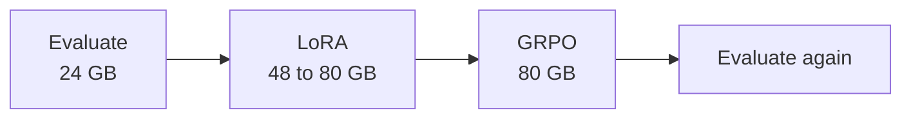

# Training jobs by GPU size

Which job fits which card, and the order of work. Memory sizes and prices are the vendor's, read 2026-11-24. Which job fits which size is a rule of thumb, not a vendor figure: check your own model, context length and batch size. The rule is in [Training](../training.md).

| Job | GPU memory | Hardware on a lane | Notes |
| --- | --- | --- | --- |
| Evaluation, small-model smoke tests | 24 GB | 1x L4 24 GB, $0.80 an hour on Hugging Face Jobs ([Jobs pricing](https://huggingface.co/docs/hub/jobs-pricing), read 2026-11-24). | Run the eval before and after every training run. |
| LoRA, mid-size model | 48 to 80 GB | L40S 48 GB is $1.80 an hour on Hugging Face Jobs ([Jobs pricing](https://huggingface.co/docs/hub/jobs-pricing), read 2026-11-24). A100 large 80 GB is $2.50 ([Jobs pricing](https://huggingface.co/docs/hub/jobs-pricing), read 2026-11-24). L40S, A100 80 GB and H100 per-second prices are on [Modal](https://modal.com/pricing), read 2026-11-24. | Use a 4-bit or 8-bit base to stay in the smaller card. |
| Single-GPU RL (GRPO) | 80 GB | A100 large 80 GB, $2.50 an hour ([Jobs pricing](https://huggingface.co/docs/hub/jobs-pricing), read 2026-11-24). A100 80 GB is $0.000694 a second on Modal ([Modal pricing](https://modal.com/pricing), read 2026-11-24). | RL holds the policy, the rollouts and often a reference model at once. Give it the largest card you have. |
| A 27B model | 96 GB or more | RTX PRO 6000 96 GB is $2.75 an hour ([Jobs pricing](https://huggingface.co/docs/hub/jobs-pricing), read 2026-11-24). H200 141 GB is $5.00 an hour per the same page. | Plan one short run. |

## Order of work

1. Evaluate the base model on the 24 GB lane and keep the score.
2. Train a LoRA adapter on a 48 to 80 GB card. Save the adapter to the Hugging Face Hub at each step, since a lane can end a session without warning.
3. Run GRPO from that adapter on an 80 GB card, with short rollouts.
4. Evaluate again and compare with step 1.
5. Cancel the Job or stop the app the same day.

A Job's default timeout is 30 minutes. Pass `--timeout` on every run ([Jobs pricing](https://huggingface.co/docs/hub/jobs-pricing), read 2026-11-24).
