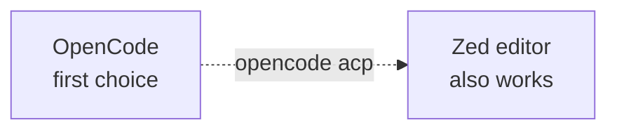

# Zed

Also works with OpenCode: Zed is an open-source editor (GPL-3.0-or-later, [README](https://github.com/zed-industries/zed), read 2026-11-26) that runs `opencode acp` as an external agent over the Agent Client Protocol (ACP). OpenCode is the way in. This page is a short secondary note, and it covers open-weight models on your own keys only.



| Account | Free tier | Login or key | OpenCode | Guard |
| --- | --- | --- | --- | --- |
| None for the editor with your own keys or an external agent ([External Agents](https://zed.dev/docs/ai/external-agents), read 2026-11-24). | Zed Free is $0 forever, with unlimited use of your own API keys or external agents ([Pricing](https://zed.dev/pricing), read 2026-11-24). | Keys saved in **Settings > AI > LLM Providers** go to the keychain, not `settings.json` ([Use API Access](https://zed.dev/docs/ai/use-api-access), read 2026-11-24). | Not confirmed for the Desktop App. Zed runs `opencode acp` ([OpenCode ACP](https://opencode.ai/docs/cli/acp), read 2026-11-24). | Zed adds no spend of its own on this route. The stop is your provider's, in its guide. See [Git Crafter compute rules](https://github.com/SoulCraft-Org/git-crafter/blob/main/rules/compute.md). |

## Wiring

| Host | Plugs in as | Source |
| --- | --- | --- |
| OpenCode Desktop App | Not confirmed. Zed runs `opencode acp` with the credentials the OpenCode CLI holds. The Desktop App is not named. | [OpenCode ACP](https://opencode.ai/docs/cli/acp), read 2026-11-24; [External Agents](https://zed.dev/docs/ai/external-agents), read 2026-11-24 |

<details>
<summary>Commands</summary>

```bash
opencode auth login
```

```json
{ "agent_servers": { "OpenCode": { "type": "custom", "command": "opencode", "args": ["acp"] } } }
```

</details>

Set up: [Zed detail](detail/zed.md). Traps and sources: [Zed traps and sources](detail/zed-traps.md).
