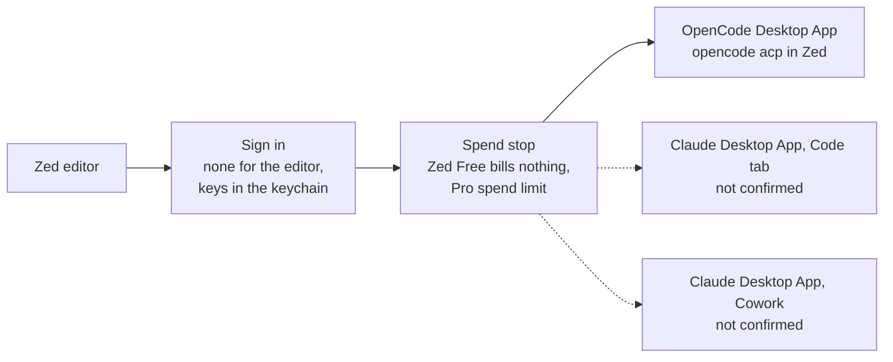

# Zed

Zed is a free editor that runs open-weight models on your own provider keys. It runs OpenCode, Goose and Claude Agent as external agents over the Agent Client Protocol (ACP).



| Account | Free tier | Login or key | Claude connector | OpenCode | Guard |
| --- | --- | --- | --- | --- | --- |
| None for the editor. A Zed sign-in is needed only for Zed-hosted models ([Plans & Pricing](https://zed.dev/docs/ai/plans-and-usage), read 2026-11-24). | Zed Free is $0 forever, with unlimited use of your own API keys or external agents ([Pricing](https://zed.dev/pricing), read 2026-11-24). | Keys saved in **Settings > AI > LLM Providers** go to the keychain, not `settings.json` ([Use API Access](https://zed.dev/docs/ai/use-api-access), read 2026-11-20). | Claude Agent from the ACP Registry. It owns its own login ([External Agents](https://zed.dev/docs/ai/external-agents), read 2026-11-24). | Install OpenCode from the ACP Registry, or add `opencode acp` as a custom agent ([OpenCode ACP](https://opencode.ai/docs/cli/acp), read 2026-11-24). | On Free, Zed bills nothing. On Pro, the spend limit defaults to $10 and accepts $0 ([Plans & Pricing](https://zed.dev/docs/ai/plans-and-usage), read 2026-11-24). [More](detail/zed.md#guard). See [Git Crafter compute rules](https://github.com/SoulCraft-Org/git-crafter/blob/main/rules/compute.md). |

## Wiring

| Host | Plugs in as | Source, read 2026-11-24 |
| --- | --- | --- |
| OpenCode Desktop App | Zed runs `opencode acp`, which uses the credentials OpenCode already holds. The Desktop App itself is not named. | [OpenCode ACP](https://opencode.ai/docs/cli/acp), [External Agents](https://zed.dev/docs/ai/external-agents) |
| Claude Desktop App, Code tab | Not confirmed. Zed's page does not name Claude Desktop. The Desktop docs list Zed only as an editor for Open in. | [External Agents](https://zed.dev/docs/ai/external-agents), [Desktop docs](https://code.claude.com/docs/en/desktop) |
| Claude Desktop App, Cowork | Not confirmed. Neither Zed's pages nor the Desktop docs name a Cowork step. | [External Agents](https://zed.dev/docs/ai/external-agents), [Desktop docs](https://code.claude.com/docs/en/desktop) |

<details>
<summary>Commands</summary>

```bash
opencode auth login
```

```json
{ "agent_servers": { "OpenCode": { "type": "custom", "command": "opencode", "args": ["acp"] } } }
```

</details>

Providers, guard and agents: [Zed detail](detail/zed.md). Traps and sources: [Zed traps and sources](detail/zed-traps.md).
