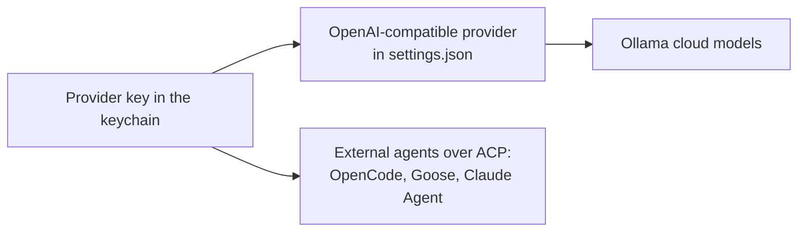

# Zed

Zed is a free editor that runs open-weight models through your own provider keys, and runs Claude Code, OpenCode and Goose as external agents over the Agent Client Protocol (ACP).

| Account | Free tier | Login or key | Claude connector | OpenCode | Guard |
| --- | --- | --- | --- | --- | --- |
| None for the editor itself ([Plans & Pricing](https://zed.dev/docs/ai/plans-and-usage), read 2026-11-20). A Zed sign-in is needed only for Zed-hosted models. | Zed Free is $0 forever, with unlimited use of your own API keys or external agents ([Pricing](https://zed.dev/pricing), read 2026-11-20). Zed-hosted models and Edit Predictions need Pro ([Plans & Pricing](https://zed.dev/docs/ai/plans-and-usage), read 2026-11-20). | Keys saved in **Settings > AI > LLM Providers** go to the system keychain, not `settings.json`. A non-empty environment variable wins over the keychain. An OpenAI-compatible provider reads `<PROVIDER_ID>_API_KEY` in upper snake case ([Use API Access](https://zed.dev/docs/ai/use-api-access), read 2026-11-20). | Claude Agent from the ACP Registry. It owns its own login and billing ([External Agents](https://zed.dev/docs/ai/external-agents), read 2026-11-20). | From the ACP Registry, or a custom agent that runs `opencode acp` ([ACP](https://opencode.ai/docs/cli/acp), read 2026-11-20). | On Zed Free, Zed bills nothing: each provider's own guard applies to its key. On Pro, the Monthly Spend Limit caps token spend past the $5 included; it defaults to $10, accepts $0, and stops usage when hit ([Plans & Pricing](https://zed.dev/docs/ai/plans-and-usage), read 2026-11-20). Per the same page, any limit above $0 lets tokens bill past the included $5. See [Git Crafter compute rules](https://github.com/SoulCraft-Org/git-crafter/blob/main/rules/compute.md). |



## Set up

1. Add a provider key in the editor. Run `agent: open settings` from the command palette, open **LLM Providers**, and paste the key there; Zed stores it in the keychain ([Use API Access](https://zed.dev/docs/ai/use-api-access), read 2026-11-20).

2. Add an OpenAI-compatible provider, such as one from these guides, in `settings.json`. Name the provider ID with care: it sets the variable Zed reads, so `my-gateway` reads `MY_GATEWAY_API_KEY` ([Use API Access](https://zed.dev/docs/ai/use-api-access), read 2026-11-20). Keep the key itself out of this file.

```json
{
  "language_models": {
    "openai_compatible": {
      "<provider-id>": {
        "api_url": "https://<base-url>/v1",
        "available_models": [{ "name": "<model>", "max_tokens": 128000 }]
      }
    }
  }
}
```

3. For Ollama, use its cloud models only, never a local pull. Set the API URL to `https://ollama.com` and give Zed a key in the provider UI or `OLLAMA_API_KEY` ([Use a Local Model](https://zed.dev/docs/ai/use-a-local-model), [Ollama: Zed](https://docs.ollama.com/integrations/zed), read 2026-11-20). See [Ollama](ollama.md) for its credits.

Steps 4 to 6 add OpenCode, Goose and Claude Agent as external agents: see [Zed agents, traps and sources](detail/zed.md).
