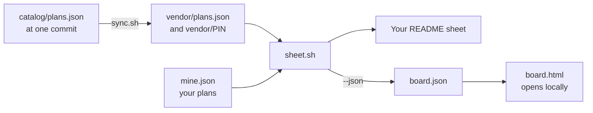

# Compute list starter

Your own list of the plans you hold, built from [catalog/plans.json](../../catalog/plans.json). Bash and jq only. The board is one HTML file that loads nothing, like the [logins starter](../logins/README.md).

| Step | Do |
| --- | --- |
| 1 | Make a private repository and copy this folder into it, with its `.gitignore` |
| 2 | Run `bash sync.sh`. It copies the catalog at a Compute Crafter commit into `vendor/plans.json` and writes that commit to `vendor/PIN` |
| 3 | Copy `mine.example.json` to `mine.json`: one row per plan, with the catalog `id` |
| 4 | Put one `<!-- sheet:start -->` line in your README, and one `<!-- sheet:end -->` line after it. Then run the sheet. If the markers are missing, repeated or out of order, `--write` exits 2 and leaves the file alone |
| 5 | Build `board.json`, open `board.html` in a browser and pick `board.json` |

```bash
bash sync.sh
bash sheet.sh vendor/plans.json mine.json --write README.md
bash sheet.sh vendor/plans.json mine.json --json > board.json
```



| File | Holds | In git |
| --- | --- | --- |
| `sync.sh` | The copy of the catalog, and its pin | yes |
| `sheet.sh` | The sheet and the board input | yes |
| `board.html` | The board, which reads `board.json` in your browser | yes |
| `mine.example.json` | Six example plans | yes |
| `mine.json` | Your plans, status and notes | yes, in a private repo |
| `vendor/plans.json`, `vendor/PIN` | The catalog copy, and `owner/repo@sha` of its commit | yes |
| `board.json` | The board's input, built from both | never |
| `.gitignore` | Keeps `board.json` and `local/` out | yes |

## mine.json

| Key | Holds |
| --- | --- |
| `plans[].id` | A catalog plan `id`. One not in the catalog is flagged with a ❔ and never dropped |
| `plans[].have` | `true` when you hold the plan |
| `plans[].status` | `use` (work runs on it), `idle` (held, unused), `want` (to claim) or `skip` |
| `plans[].notes` | Your words. The sheet prints them as text, never as markup |
| `plans[].lane`, `plans[].rung` | Optional. A ladder plan: its lane (`GPU`, `Inference`, `CI`, `CPU`, `Agents`) and its place in that lane, 1 first. `--ladders` prints them |

## Ladders

A ladder is your order of use inside one lane: the first rung that still has room, then the next. Free rungs come first, a paid rung last, and a paid rung waits for your yes. Give each plan a `lane` and a `rung` in `mine.json`, then run:

```bash
bash sheet.sh vendor/plans.json mine.json --ladders
```

| Lane | Rung | Plan | Have | Status | At the limit | Notes |
|---|---:|---|:-:|:-:|:-:|---|
| GPU | 1 | A monthly free credit | ✅ | 🟢 use | 💸 bills | Set a workspace budget so it stops |
| GPU | 2 | A subscription with a GPU quota | ✅ | 🟢 use | 🛑 stops | Buy no extra credits |
| GPU | 3 | A paid plan | · | ⭐ want | 💸 bills | Only after rungs 1 and 2 run out, on your yes |

Put each plan's guard in its notes: a limit, a budget, or "buy no credits". `--json` rows carry `lane` and `rung`, null when a plan has none.
