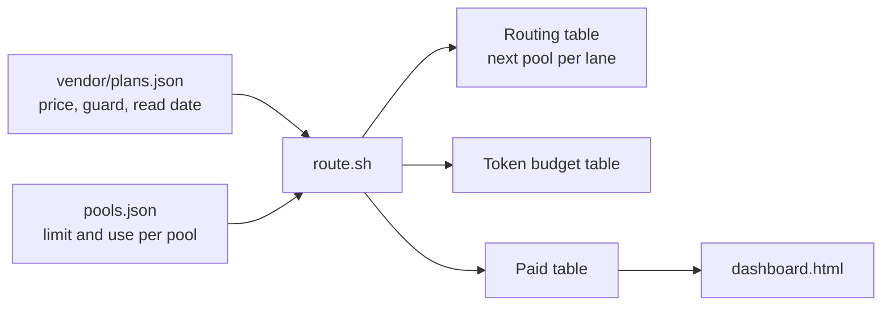
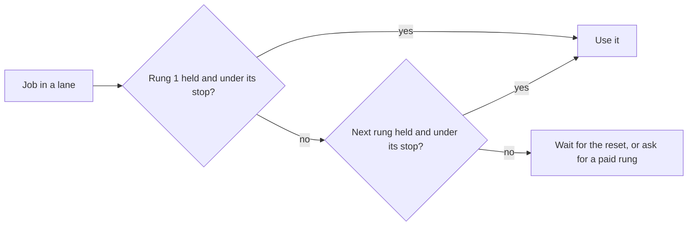

# Pool routing starter

Route each job to the first pool with room, keep a token budget per pool, and see which paid plans are in use. Built on the [compute-list starter](../compute-list/README.md): it reads the same catalog copy, `vendor/plans.json`. Bash and jq only. The dashboard is one HTML file that loads nothing.

A pool is one allowance that resets on a clock, such as a daily request cap or a monthly credit. Each pool is a row of [catalog/plans.json](../../catalog/plans.json), so its price, its guard and the date its limit was read come from the catalog.

| Step | Do |
| --- | --- |
| 1 | Set up the [compute-list starter](../compute-list/README.md) in your private repository, so `vendor/plans.json` exists |
| 2 | Copy this folder's files into the same folder, and add its `.gitignore` lines to yours |
| 3 | Copy `pools.example.json` to `pools.json`: one row per pool, with the catalog `id`, its `lane` and `rung`, and its limit and use |
| 4 | Print the routing table, the token budget table or the paid table with `route.sh` |
| 5 | Build `dashboard.json`, open `dashboard.html` in a browser and pick `dashboard.json` |

```bash
bash route.sh vendor/plans.json pools.json
bash route.sh vendor/plans.json pools.json --budget
bash route.sh vendor/plans.json pools.json --paid
bash route.sh vendor/plans.json pools.json --json > dashboard.json
```



| File | Holds | In git |
| --- | --- | --- |
| `route.sh` | The routing, budget and paid tables | yes |
| `dashboard.html` | The paid and in use dashboard, which reads `dashboard.json` in your browser | yes |
| `pools.example.json` | Seven example pools, with made-up use | yes |
| `pools.json` | Your pools, limits and use | yes, in a private repo |
| `dashboard.json` | The dashboard's input, built from both | never |
| `.gitignore` | Keeps `dashboard.json` and `local/` out | yes |

## pools.json

| Key | Holds |
| --- | --- |
| `stop_at_pct` | Where a pool stops taking work, as a share of its limit. 80 is the goal of the `credits.highest_used_share` metric |
| `pools[].id` | A catalog plan `id`. One not in the catalog is flagged with a ❔ and never dropped |
| `pools[].lane`, `pools[].rung` | The lane the pool serves and its place in that lane, 1 first. Free rungs come first, a paid rung last |
| `pools[].unit`, `pools[].per` | What the limit counts (`requests`, `tokens`, `minutes`, `USD of credits`) and its window: `day`, `week` or `month` |
| `pools[].limit` | The published limit. Copy it from the catalog row's `includes`, and leave it out where none is published |
| `pools[].used` | Use so far this window, in the same unit |
| `pools[].have` | `true` when you hold the plan. A pool you do not hold is never routed to |
| `pools[].notes` | Your words. The tables print them as text, never as markup |

## Routing

`route.sh` sends a lane's work to its first held pool under its stop. A pool at the stop is skipped until its window resets. A paid rung you do not hold waits for your yes.



## Token budget

The table is `route.sh vendor/plans.json pools.json --budget` on `pools.example.json`. Stop at is the limit times `stop_at_pct`. Per day is Stop at over the window's days, where a month counts 30 days and a week 7. Left is Stop at less Used, never below 0.

| Pool | Unit | Window | Limit | Stop at | Per day | Used | Left |
|---|---|---|---:|---:|---:|---:|---:|
| GitHub Actions on GitHub Free | minutes | month | 2000 | 1600 | 53.33 | 300 | 1300 |
| Hugging Face ZeroGPU (free account) | minutes | day | 5 | 4 | 4 | 1 | 3 |
| NVIDIA API Catalog trial (build.nvidia.com) | requests | day | 10000 | 8000 | 8000 | 2500 | 5500 |
| Cloudflare Workers AI free daily allocation | neurons | day | 10000 | 8000 | 8000 | 9000 | 0 |
| Ollama Pro | USD of credits | month | 60 | 48 | 1.6 | 20 | 28 |
| GitHub Copilot Pro | AI credits | month | 1500 | 1200 | 40 | 0 | 1200 |

Each limit is the figure in the catalog row, read on the vendor's page on the row's `checked` date.

## Paid and in use

A paid plan is a held catalog row with a price above 0. It is in use when its use this window is above 0, and idle otherwise. An idle paid plan is paused or dropped. The counts match the `credits.paid_plans_in_use` metric, which keeps counts only and never a plan's name or price. This is `route.sh vendor/plans.json pools.json --paid` on `pools.example.json`.

**2 paid plans held** · 🟢 in use 1 · 💤 idle 1

| Plan | Price | Used | State |
|---|---:|---:|:-:|
| Ollama Pro | USD 20 | 20 of 60 USD of credits | 🟢 in use |
| GitHub Copilot Pro | USD 10 | 0 of 1500 AI credits | 💤 idle: pause or drop |
