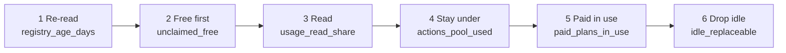

# Process starter

The Spend map on your own Process page: six steps from re-reading a free tier to dropping idle capacity. [config.json](config.json) is the Process config and its maps file in one. Copy it to `<your repo>/quality/process/config.json`, set `repos`, `repo_url` and `heading`, and keep the map.

| Step | Do |
| --- | --- |
| 1 | Set up the [quality starter](../quality/README.md) first: this map reads its Credits tab |
| 2 | Copy `config.json` to `quality/process/config.json` |
| 3 | Set `repos`, `repo_url` and `heading` to your repo |
| 4 | Push. Git Crafter's `pages.yml` draws the page, with `pages: process quality` and `quality-config: quality/config.json` |

| Step | Metric | Fed by |
| --- | --- | --- |
| 1 Re-read | `credits.registry_age_days` | The `read` dates in `inputs/systems.json`, `checked` in `inputs/registry/free.json`, and the pack's `catalog/plans.json` |
| 2 Free first | `credits.unclaimed_free` | Rows in `inputs/registry/free.json` marked `could_claim`, in the lanes of `claim_lanes` |
| 3 Read | `credits.usage_read_share` | `inputs/usage.json` against every claimed allowance |
| 4 Stay under | `credits.actions_pool_used` | The allowance marked `pool: true` and named in `pool_metrics`, with its use in `inputs/usage.json` |
| 5 Paid in use | `credits.paid_plans_in_use` | The allowances marked `paid: true`, or registry rows with `price_month` above 0, with their use in `inputs/usage.json`. The [pool routing starter](../pools/README.md) prints the same counts |
| 6 Drop idle | `credits.idle_replaceable` | Allowances in a lane whose other allowance has used all it includes |

| Key | Set it to |
| --- | --- |
| `repos` | Your repo's name |
| `repo_url` | `https://github.com/<owner>/<repo>/blob/main`, where each rule link points |
| `maps` | `{ "use": "spend" }`. The pack at the SHA in `quality/config.json` supplies the six steps. Add Git Crafter's library maps beside it with more `use` entries |
| `heading` | Your repo's name |

Each step reads its metric from the Credits tab. Until a local run feeds the other five, only step 1 shows a value from CI. The pin and the local run are in the [quality starter](../quality/README.md).
