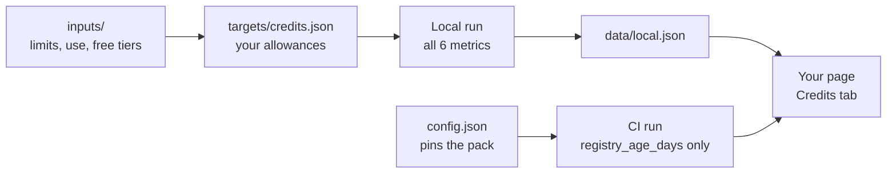

# Quality starter

Your own Quality, Speed and Consumption page for the free tiers and credits you hold. It loads the Credits pack of this repo at one commit, and reads three small files you own. Copy this folder to `quality/` in your repo. Every file here holds fake example data from `example.com`.

| Step | Do |
| --- | --- |
| 1 | Copy this folder to `<your repo>/quality/`, with its `.gitignore`. Add `.code-os-packs/` to your repo's root `.gitignore` |
| 2 | Check the pin in `config.json`: `SoulCraft-Org/compute-crafter@<40-hex sha>`. To move to a newer commit, paste its full SHA. A tag or branch is refused, because a pack runs in CI |
| 3 | Replace the fake data: `inputs/systems.json` (limits), `inputs/usage.json` (use this cycle) and `inputs/registry/free.json` (free tiers). Then list your allowances in `targets/credits.json` |
| 4 | Run it on your machine: clone the pack at the pinned SHA into `.code-os-packs/SoulCraft-Org/compute-crafter`, then run `node <git-crafter>/quality/collect.mjs --local --only credits` from your repo's root |
| 5 | Copy Git Crafter's [`pages.yml`](https://github.com/SoulCraft-Org/git-crafter/blob/main/templates/ci/pages.yml) and the [process starter](../process/README.md). A push to main builds your page |

## What each metric reads

| Metric | Kind | File it needs | Runs |
| --- | --- | --- | --- |
| `credits.idle_replaceable` | quality | `inputs/systems.json`, `inputs/usage.json`, `inputs/registry/free.json` | local |
| `credits.unclaimed_free` | quality | `inputs/registry/free.json` | local |
| `credits.highest_used_share` | quality | `inputs/systems.json`, `inputs/usage.json` | local |
| `credits.actions_pool_used` | consumption | `inputs/systems.json`, `inputs/usage.json` | local |
| `credits.usage_read_share` | speed | `inputs/usage.json` | local |
| `credits.registry_age_days` | speed | the read dates in `inputs/`, and the pack's `catalog/plans.json` | CI and local |

A CI run reads no file of yours, so five metrics stay "not measured" there until a local run feeds them. `targets/credits.json` is one entry: Git Crafter merges a targets file's params key by key, so it feeds all six.

## Readers for an allowance's use

An allowance can carry a `reader` in `targets/credits.json`, so a `--local` run writes its use instead of you typing it. A reader that cannot read says why on the page and never counts as 0.

| Reader | Reads | Needs |
| --- | --- | --- |
| `{ "claude_cost": true }` | The Claude Console cost report's spend this UTC month, in USD ([Usage and Cost API](https://platform.claude.com/docs/en/manage-claude/usage-cost-api), read 2026-11-23) | An Admin API key (`sk-ant-admin...`) in the env var `ANTHROPIC_ADMIN_KEY`. A normal API key cannot read it. Priority Tier cost is not in the report |
| `{ "gcp_billing_export": "project.dataset.table" }` | This invoice month's Google Cloud cost before credits, from the billing export's standard usage cost table, by `bq query` ([export](https://docs.cloud.google.com/billing/docs/how-to/export-data-bigquery), read 2026-11-23) | The export turned on in the Cloud Billing console, `bq` from the Google Cloud CLI, your own `gcloud auth login`, and BigQuery read access to the table. The credits and net cost go in the row's source text |

## Files

| File | Holds | In git |
| --- | --- | --- |
| `config.json` | The pack pin, and the one tab shown | yes |
| `targets/credits.json` | Paths, claim lanes, allowances and what each could take over | yes |
| `inputs/systems.json` | Each allowance's limit, the vendor page and the date read | private repo only |
| `inputs/usage.json` | What each allowance has used this cycle | private repo only |
| `inputs/registry/free.json` | One row per free tier: lane, price, `org_status` | private repo only |
| `.gitignore` | The page build's output | yes |

## Paths

| Path form | Reads from |
| --- | --- |
| `<your repo>/quality/inputs/x.json` | Your repo's root, so your own files |
| `~/compute/x.json` | Your home folder |
| `pack:catalog/plans.json` | The pack's checkout at the commit you pin, so the page also scores the age of the public catalog. A `pack:` path cannot leave the checkout |
