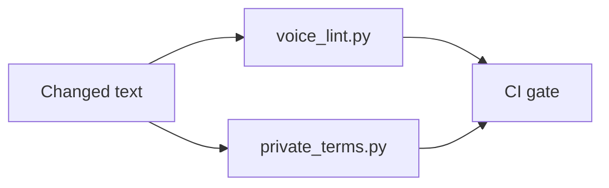

# Tools

Python checks that guard this repo's text. Each is one file.

| Tool | Does | Run by |
| --- | --- | --- |
| `tools/voice_lint.py` | Fails on em dashes and warns on long sentences, hedges and unattributed figures | CI, and you before a push |
| `tools/voice_rules.json` | The generic rule shapes `voice_lint.py` reads. Private names never go here | `voice_lint.py --rules` |
| `tools/private_terms.py` | Scans every tracked file for the private-terms list and prints each hit as `path:line` only | [private-terms.yml](../.github/workflows/private-terms.yml) |
| `tools/claude_review.py` | Sends one pull request's diff to Claude once and posts a "Security review:" comment | [claude-review.yml](../.github/workflows/claude-review.yml) |

Run `python3 -I tools/voice_lint.py --rules tools/voice_rules.json <file>`. The private names live in an org secret, never in this repo ([AGENTS.md](../AGENTS.md)).
